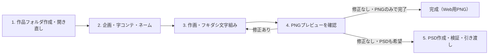

# 漫画制作キット（MangaAgentsStudio-A）

AIエージェント（Codexなど）と一緒に漫画を企画し、字コンテ・ネーム・作画・文字組み・PNGでの確認、希望時のPSD書き出しまでを進めるための**知識・12のスキル・補助スクリプト・作品テンプレート集**です。

> [!IMPORTANT]
> - **このキットは単体で起動する漫画作成アプリではありません。** 対話して制作を進めるAIエージェント（Codex、Claude Code、Antigravityなど）と、絵を作る画像生成手段（Codex環境で利用可能な画像生成ツール、NovelAI API、PixAI API、ローカルComfyUIなど）を別にご用意ください。
> - **このフォルダは制作キットの保守・配布用です。** 漫画は原則ここで直接描かず、キット外（既定は1つ上の階層の `../作品名/`）に作品ごとのプロジェクトフォルダを作成し、**その作品フォルダでエージェントを開き直して**制作を始めます。`templates/manga-project/` は配布用の原本なので、直接作品を書き込まないでください。

完成イメージや制作条件の実例は **[公開作例一覧](examples/README.md)** をご覧ください（作例は閲覧用で、新規作品にはコピーされません）。

---

## できること

作成した作品プロジェクトを開いた後、AIエージェントとの会話で次の作業を進められます。

- **企画・字コンテ・ネーム**：読者体験と物語を設計し、キャラクター設定・字コンテからページ別のネームへ具体化する。
- **コマ割り設計**：コマ割りテンプレート集（全79種類）を基本に、演出意図に合わせてページを設計する。
- **多角的なレビューと場面監修**：物語、没入感、映画的演出、読みやすさ、用語、キャラの一貫性を点検し、場面で狙う笑い・魅力・感情・関係・展開（全16テーマ）の表現案やPNG確認後の改善案を得る。
- **作画・フキダシ組版・PNG確認**：利用可能な画像生成手段で作画し、必要に応じてコマ枠・フキダシ・縦書きセリフを組版して、PNGプレビューで確認・修正する（NovelAI / PixAI ではブラウザー画面で操作できるローカルWebUIも同梱）。
- **希望時のPSD引き渡し**：PNGの修正がなくなったら、作成指示のある場合に限りレイヤー分けされたPSDを作成・検証して引き渡す（CLIP STUDIO PAINT等での仕上げ用）。
- **動画での演出試作（任意）**：明示依頼がある場合に、ローカルComfyUIとffmpegを使った動画試作を補助する。

---

## 利用方法の選択（ローカル環境 / ChatGPT Work）

お使いの環境に合わせて、次の2通りの入り口から選べます。

| 利用方法 | 特徴・向いている用途 | 使える機能の範囲 |
| --- | --- | --- |
| **1. ローカルのCodex等で使う（標準・推奨）** | PCにこのキットを展開し、ローカルフォルダを扱えるCodex（デスクトップアプリ／VS Code拡張機能）、Claude Code、Antigravityで開く方法 | **用意した環境・権限に応じた機能を利用可能。** キット外への作品フォルダ作成、同梱スクリプトによる組版、NovelAI / PixAI の一括生成とローカルWebUI、PNGプレビュー、希望時のPSD出力に対応（必要な作画手段・Python環境・実行権限の条件や未検証事項は次節を参照） |
| **2. ChatGPT Work等にURLを渡して使う（簡易利用）** | ローカルに環境を作らず、ChatGPT Work等の会話にこのリポジトリのURL（`https://github.com/potechitakusan/MangaAgentsStudio-A`）を渡して指示する方法 | リポジトリ内の知識・制作工程・コマ割り方針を参照した企画、字コンテ、ネーム相談、およびその会話環境で利用可能な範囲での画像生成などのおおよその機能 |

### ChatGPT WorkにURLを渡して使う場合の依頼例と注意点

ChatGPT Work等でリポジトリURLを参照させる場合は、次のように依頼します。

> **依頼文例（ChatGPT Work）：**
> 「`https://github.com/potechitakusan/MangaAgentsStudio-A` の構成と漫画制作ルールを参照してください。女性2人が休日にボードゲームをして最後に逆転する2ページ漫画を企画し、字コンテ・ネームから進めてください。この環境で画像生成やファイル出力が使えるかも最初に確認してください。」

- **ローカル環境との違い**：URLを渡しただけでは、手元のPCに作品フォルダが作られたり、ローカル用の全スキル・APIキー・Pythonスクリプト環境が自動構築されたりするわけではありません。
- **環境依存の制約**：リポジトリの取得範囲、ファイル保存、スクリプト実行、画像生成の可否、および生成物のダウンロード方法は、実行しているChatGPT Work側の機能・権限に依存します（未確認の動作や受取方法は保証しません）。
- **作業フォルダの原則**：実行環境内でリポジトリを展開してファイル操作ができる場合も、`templates/manga-project/` の原本を直接書き換えず、キット外に作品用フォルダを作って進める原則は維持してください。

---

## 必要環境と作画手段の一覧

制作を進める**AIエージェント**と、実際に絵を描く**作画手段**は別々に選べます。**すべてのサービスを契約・導入する必要はなく、使いたい作画手段を1つ用意すれば制作できます。**

### 1. 制作を進めるAIエージェント（どれか1つ）

| エージェント | 作品作成時の指定 | 特徴・注意点 |
| --- | --- | --- |
| **Codex**（ChatGPTアプリ / VS Code拡張等） | 指定なし（既定） | このキットの標準環境。**すべてのCodex環境に内蔵の画像生成（imagegen）があるとは限らない**ため、作品開始時に現在の会話で画像生成ツールが使えるかを確認します（使えない場合はNovelAIやPixAI等を選択） |
| **Claude**（Claude Code等） | `-AgentMode Claude`<br>（Linuxは `--agent-mode Claude`） | 作品に `CLAUDE.md` と読み替え規則（`AGENT-MODE.md`）を追加。内蔵の画像生成はないため、既定でNovelAIやPixAI等の外部作画＋別組版を使用 |
| **Gemini（Antigravity）** | `-AgentMode Antigravity`<br>（Linuxは `--agent-mode Antigravity`） | 作品に `GEMINI.md` と専用の `AGENT-MODE.md` を追加。利用可能な生成・画像表示機能を確認して作画（既定はNovelAI等のコマ別生成＋別組版）。※Gemini CLI用ではありません。Antigravity実機での動作は未検証です |

### 2. 作画手段（どれか1つを選択）

| 作画手段 | 必要な準備・APIキー | 追加費用・利用枠の扱い | 文字・フキダシ・枠の扱い | 検証状況・詳細ガイド |
| --- | --- | --- | --- | --- |
| **Codex内蔵の画像生成（imagegen）** | 画像生成ツールが利用可能なCodex環境（APIキーの追加設定は不要） | ChatGPT / Codexプランの画像生成利用枠を消費（サイズ・品質・再生成回数で変動） | 番号付きレイアウト画像を渡し、**文字・フキダシ込みで1ページ一括生成**するのが基本 | 動作確認済み。<br>[コマ割りと生成方針](docs/knowledge/panel-layout-policy.md) |
| **NovelAI API**<br>（V5既定 / V4.5） | NovelAIアカウントと **Persistent API token**（`NOVELAI_API_KEY`）、Python 3.10以上 | 有効な**Opus契約**で条件内（1回1枚・28steps以下・標準寸法・追加有料機能なし）なら **0 Anlas**（V5利用上限の残量確認が必要）。未契約や有料条件はAnlasを消費（明示許可時のみ実行） | コマ別に文字・枠なしの絵を生成し、**後からスクリプトで枠・フキダシ・縦書き文字を組版** | 1枚生成・一括生成・WebUIを確認済み（i2i等の画像入力は未検証）。全11画風の見本あり。<br>[NovelAI制作手順](templates/manga-project/docs/knowledge/novelai-composed-production.md)・[API接続手順](docs/knowledge/novelai-api.md) |
| **PixAI API**<br>（Tsubaki.2既定・公式15モデル収録） | PixAIアカウントと **APIキー**（`PIXAI_API_KEY`）、Python 3.10以上 | **生成のたびにPixAIクレジットを消費。** 残高照会APIがないため、人間が残高と枚数を確認し明示許可した範囲だけ実行 | コマ別に文字・枠なしの絵を生成し、**後からスクリプトで枠・フキダシ・縦書き文字を組版** | v2生成・WebUI・一部v1機能を確認済み（検証途中の機能あり。LoRA効果・モデル別消費量は未確定）。モデル15種＋画風35種の見本あり。<br>[PixAI制作手順](templates/manga-project/docs/knowledge/pixai-composed-production.md)・[API接続手順](docs/knowledge/pixai-api.md) |
| **外部生成・下絵参照i2i**<br>（ComfyUI / Qwen-Image 2.1等） | ローカルComfyUIまたは外部生成環境、下絵（Blender撮影画像等）やキャラ参照画像 | ローカル実行はマシン資源を使用（外部サービス利用時は各サービスの条件に従う） | コマ別に作画し、後から枠・フキダシ・文字を組版 | Qwen-Image 2.1での制作記録を収録（他モデルでの同等効果は未検証）。<br>[外部生成によるコマ作画](docs/knowledge/external-panel-i2i.md) |

### 3. OS・Python・追加パッケージと仕上げツールの条件

「Pythonの追加パッケージ不要」で動く範囲と、`Pillow` 等の画像処理パッケージが必要になる工程は次のように分かれています。

| 作業・工程 | 必要なOS・実行環境 | Python追加パッケージ・外部ツール |
| --- | --- | --- |
| **作品プロジェクトの作成** | ・Windows：Windows PowerShell 5.1以上<br>・Linux：Bash + Python 3.10以上<br>（※Macは公式アプリ手順の参照情報のみで実機未検証） | **追加パッケージ不要**（標準ライブラリのみ。Windowsでも前の作品から必須工程を引き継ぐ場合のみPython 3.10以上を使用）。通常利用ではGitも不要 |
| **APIキー確認・契約照会・要求JSON作成・WebUIの起動自体** | Python 3.10以上（`novelai_api.py`、`novelai_compose.py`、`pixai_api.py`、`pixai_compose.py`、各WebUIサーバー） | キー確認・契約照会・通常のテキストからの要求作成・WebUI起動は**追加パッケージ不要**。PixAIの**i2i・インペイント要求作成**（元画像・マスクの寸法確認）とWebP/JPEG応答のPNG変換には **`Pillow` が必要** |
| **フキダシ・縦書き文字の組版、ページPNGビルド、マスク作成** | Python 3.10以上（`typeset_manga.py`、`novelai_batch.py build`、`pixai_batch.py build`、`pixai_mask.py`） | **`Pillow` が必要**（フォントは作品の `assets/fonts/` またはOS標準の日本語フォントを使用） |
| **組版済みPSDの書き出しと再読込検証** | **Python 3.12以上**（同梱の固定依存版を使用する場合。`export_composed_psd.py`、各 `build --write-psd`） | **`Pillow`、`numpy`、`psd-tools` が必要**（作品の `scripts/requirements-composition.txt` に記載。固定版 `numpy==2.5.3` はPython 3.12以上が必要。出典は[作品側セットアップ](templates/manga-project/docs/SETUP.md)） |
| **任意の日本語推敲スキル導入** | 作品の `OPTION.md` で有効にした場合のみ（既定は無効） | `humanizer-jp` は **Git** を使用。`japanese-natural-writing` は **Gemini（agy）環境**と利用枠消費の明示許可が必要 |
| **最終仕上げ（任意）** | **CLIP STUDIO PAINT**（人間が仕上げて公開する場合の基本想定） | **Web用PNGを受け取るだけなら必須ではありません。** レイヤー分けPSDを仕上げる場合に使用 |
| **動画での演出試作（任意）** | 明示的に動画試作を依頼した場合のみ（通常の漫画制作では不使用） | Python 3.10以上、`ffmpeg`、`ffprobe`、ローカルComfyUI |

---

<a id="はじめ方"></a>

## はじめ方（最初の作品を作る最短手順）

コマンドを自分で打たなくても、Codexに頼むだけで作品フォルダの作成から始められます。

### Step 1. このキットを取得して展開する

次のどちらかの方法で、手元のPCにキットのフォルダを用意します。

- **Gitを使わない方法（手軽）**：GitHubページの緑色の「**Code**」ボタン →「**Download ZIP**」を選び、ダウンロードしたZIPファイルをPC内の作業用フォルダに展開します。
- **Gitを使う方法**：`git clone https://github.com/potechitakusan/MangaAgentsStudio-A.git` を実行します。

### Step 2. キットのフォルダをCodexで開き、作品作成を依頼する

展開したキットのフォルダ（この `README.md` があるフォルダ）をCodex（ChatGPTデスクトップアプリまたはVS Code拡張機能）で開き、次のように伝えます。

> **最初の依頼文例（キット側で実行）：**
> 「このキットの手順で、キット外に『はじめての漫画』という作品プロジェクトを作ってください。作成先と、次に開くフォルダを案内してください」

Codexが作成スクリプトを実行し、作成された作品フォルダの**絶対パス**（通常は1つ上の階層の `../はじめての漫画/`）を案内します。

### Step 3. 作成された作品フォルダでCodexを開き直す

案内された**作品フォルダの絶対パス**をアプリまたはVS Codeで開き、そこで**新しいCodexの会話**を始めます。

- 作成スクリプトを実行しただけでは、今開いている会話の作業フォルダは切り替わりません。必ず作品フォルダ側で新しい会話を始めてください。
- Codexは作成完了時に「このフォルダでCodexを開き直してください」と案内し、**「やり方がわからない場合は、ご利用の環境（Windows／Mac、アプリ／VS Code）を教えてください。必要な手順をご案内します」**と添えます。開き方がわかる場合は返信せず、そのまま作品フォルダを開いて構いません（詳しくは[Codexでの開き直し](docs/knowledge/codex-operation.md#作品フォルダでcodexを開き直す)）。
- 制作に使う知識・スキル・スクリプトは作品フォルダへコピーされますが、**NovelAIの画風見本**（`resources/novelai-style-samples/index.html`）と**PixAIのモデル・画風見本**（`resources/pixai-model-samples/index.html`）はキット側を参照するため、キットのフォルダも削除せず残しておいてください。

### Step 4. 作品フォルダで漫画制作を依頼する

作品フォルダ側の新しい会話で、作りたい漫画のキャラクター・あらすじ・ページ数を伝えます。

> **作品側の依頼文例（imagegen等、使える手段を確認して進める場合）：**
> 「女性2人が休日にゲームをする、最後にオチのある2ページ漫画を作ってください。まず利用できる画像生成手段を確認して、Web用PNGまで進めてください。PSDは不要です」

> **作品側の依頼文例（NovelAI または PixAI を指定する場合）：**
> 「女性2人が休日にゲームをする、最後にオチのある2ページ漫画を作ってください。作画はNovelAI（またはPixAI）を使い、まず画風見本とAPIキーの接続確認から案内してください。Web用PNGまで進め、PSDは不要です」

- 上記は会話の例です。画像生成手段（内蔵imagegen、または設定済みのNovelAI / PixAI / 外部画像環境）が何もない状態で自動的に絵が完成するわけではありません。
- 作品内の `docs/story/BRIEF.md`・`docs/PLAN.md`・`docs/PROGRESS.md` などの記録ファイルは、会話の内容からCodexが作成・更新します。**人間が最初にすべての設定ファイルや企画書を手で埋める必要はありません**（コマ割り方針や寸法などの好みを変えたい場合だけ、会話で伝えるか作品の `OPTION.md` を編集します）。

---

## 自分で作品を作成するOS別コマンド（手動実行・Claude / Antigravity指定）

Codexに任せず自分でターミナルから作品プロジェクトを作成する場合や、Claude Code・Antigravity用のモードを指定する場合は、キットのルートで以下を実行します。

### Windows PowerShell（5.1以上）

```powershell
# 配置先の確認のみ（ファイルは作成しません）
.\scripts\New-MangaProject.ps1 -ProjectName '作品名' -WhatIf

# 既定（Codex用）で ../作品名/ に作成
.\scripts\New-MangaProject.ps1 -ProjectName '作品名'

# Claude（Claude Code等）で制作する場合（CLAUDE.md と AGENT-MODE.md を追加）
.\scripts\New-MangaProject.ps1 -ProjectName '作品名' -AgentMode Claude

# Gemini（Antigravity）で制作する場合（GEMINI.md と専用の AGENT-MODE.md を追加）
.\scripts\New-MangaProject.ps1 -ProjectName '作品名' -AgentMode Antigravity

# 作成先の親フォルダを変える場合や、前の作品から登録済みの必須工程を引き継ぐ場合
.\scripts\New-MangaProject.ps1 -ProjectName '作品名' -DestinationParent '..' -ProcessRequirementsFrom '..\前の作品'
```

### Linux（Bash + Python 3.10以上）

PowerShellをインストールせずに使用できます。ZIP展開等で実行権限が失われていても `bash` 呼び出しで実行できます。

```bash
# 配置先の確認のみ（--dry-run も同義）
bash scripts/New-MangaProject.sh --project-name '作品名' --what-if

# 既定（Codex用）で ../作品名/ に作成
bash scripts/New-MangaProject.sh --project-name '作品名'

# 別の既存親フォルダ、Claude用モード、Antigravity用モード、必須事項の引継ぎ
bash scripts/New-MangaProject.sh '作品名' --destination-parent .. --agent-mode Claude
bash scripts/New-MangaProject.sh '作品名' --agent-mode Antigravity
# bash scripts/New-MangaProject.sh '次の作品' --process-requirements-from '../前の作品'
```

- 作品名には日本語・空白を使えます。既存の同名フォルダは上書きせず、シンボリックリンク等を経由するコピーも拒否します。
- `PYTHON` 環境変数でPython実行パスを指定でき、未指定時は `python3` → `python` の順に探します。
- Antigravity用モードの詳細は[読み替えの内容と確認範囲](templates/manga-project/agent-modes/antigravity/AGENT-MODE.md)を参照してください。

### 任意機能のスクリプト（初回は実行不要）

作品作成後、必要に応じて作品フォルダ内で以下の補助スクリプトを使えますが、**通常の漫画制作を始める前に人間が手動実行する必要はありません**（必要な場面でAIエージェントが案内・実行します）。

```bash
# レビューの重点配分を確認する場合（Windowsは .\scripts\Resolve-ReviewProfile.ps1）
bash scripts/Resolve-ReviewProfile.sh

# OPTION.mdで日本語推敲スキルを有効にした場合の導入（既定は無効。許可手順は docs/knowledge/optional-skills.md）
bash scripts/Initialize-OptionalSkills.sh

# プロセスチェッカーで登録した自分用の必須工程を確認する場合（既定は0件）
python3 scripts/process_checker.py status
```

---

## 制作の流れと役割分担（PNG確認・希望時のPSD）

作品フォルダで制作を始めると、以下の順序で進みます。詳細な状態遷移や各工程のチェック項目は[制作プロセス](docs/knowledge/manga/08-workflow-review.md)と[ノウハウ一覧](templates/manga-project/docs/MANGA-KNOWHOW.md)にまとめています。



### 人間とAIエージェントの役割分担

| 段階 | 人間（あなた）が行うこと | AIエージェント（Codex等）が行うこと | 希望時のみ行うこと（任意） |
| --- | --- | --- | --- |
| **準備・企画** | 作品フォルダで新しい会話を始め、キャラ・あらすじ・ページ数・使う作画手段を伝える | `OPTION.md` の確認、`BRIEF.md`・`PLAN.md`・`PROGRESS.md` の記入、字コンテ・コマ割り・ネームの作成とレビュー | `OPTION.md` での詳細設定、場面監修の相談、日本語推敲スキルの有効化 |
| **作画・組版** | 画風・モデルの選択、**API生成前の費用・利用枠の確認と実行許可** | プロンプトの組み立て、内容照合、許可範囲での生成実行、枠・フキダシ・縦書きセリフの組版と点検 | ローカルWebUIでのプロンプト・変数編集や候補画像の選択 |
| **PNG確認** | 提示されたPNGプレビュー（またはページ送りHTML）を見て、修正点やOKを伝える | 指摘された箇所の再生成・組版調整・再提示（返答があるまで待機） | 場面監修スキルによるPNG改善案の相談 |
| **PSD・仕上げ** | PNGに修正がないことを確認した上で、PSDを作るか回答する | 指示がある場合にPSDを作成・再読込検証し、セリフ原文（`DIALOGUE.md`）とともに引き渡す | CLIP STUDIO PAINTでの仕上げ、印刷設定（`PRINT-OPTION.md`）、CBZ作成、動画試作 |

### PNG・PSD・印刷設定の位置づけと注意点

- **基本はWeb用PNGで確認**：まずPNGプレビューを提示し、修正がなくなるまで調整します。返答がない状態を「修正なし」とは扱いません。
- **PSD作成はPNG確認後・希望時のみ**：最初から「PSDは不要」「PNG確認後にPSDも作って」と伝えてあればその通りに進め、未指定ならPNGの確認後に「PSDを作成しますか？」と質問して回答を待ちます（詳しくは[PSD引き渡しルール](docs/knowledge/psd-handoff.md)）。
- **PSDで編集できる範囲の正確な理解**：
  - PSDは**制作時に実際に分けて保持できた素材単位**をレイヤーとして格納します。NovelAI / PixAI の組版ビルド（`--write-psd`）では、未加工の採用原画（非表示グループ）、コマ枠マスク付きの配置画像、フキダシ・文字の透明レイヤーを分けて保存します。
  - 一方、**`imagegen` で絵・フキダシ・文字を1枚の画像として一体生成した場合、PSDにしても人物・背景・文字が自動的に別レイヤーに分かれたり、画像内の文字がテキストツールで直接打ち直せる文字列レイヤーになったりするわけではありません。** 画像化された文字をCLIP STUDIO PAINT等で入れ直せるよう、確定したセリフ原文を `docs/production/DIALOGUE.md` に保存して一緒に引き渡します。
- **印刷設定（`PRINT-OPTION.md`）**：同人誌などの印刷入稿用設定は `PRINT-OPTION.md` に分離しています（既定は無効・実験的導入）。Web公開用PNGだけを作る場合は記入不要です。

---

## NovelAI / PixAI の設定とローカルWebUIの使い方

NovelAI または PixAI を使ってコマ素材を生成し、ページを組版する手順です。

### 1. 初回セットアップ（作品フォルダ内）

1. **APIキーを設定する**：作品フォルダの `.env`（または `.secrets/novelai.env`・`.secrets/pixai.env`）にキーを1行で記入します（詳細は次節「[費用・外部送信・APIキー管理](#費用外部送信apiキー管理)」）。
2. **接続を確認する（画像生成・課金なし）**：エージェントに「NovelAI（またはPixAI）の接続を確認して」と伝えるか、作品フォルダのターミナルで以下を実行します。
   ```powershell
   # NovelAI の場合（Windowsは python、Linuxは python3）
   python -X utf8 scripts/novelai_api.py key-status
   python -X utf8 scripts/novelai_api.py status

   # PixAI の場合
   python -X utf8 scripts/pixai_api.py key-status
   python -X utf8 scripts/pixai_api.py status
   ```
3. **画風・モデルを選ぶ**：キット側の見本カタログ（NovelAIは `resources/novelai-style-samples/index.html` の11画風、PixAIは `resources/pixai-model-samples/index.html` の公式15モデル＋35画風プリセット）から使いたい画風・モデルを選びます。
4. **プロンプト編集ガイド**：キャラクターの外見・絵柄・背景（PixAIはLoRAも）を変数化して自分で書き換えたい場合は、作品内のガイドを参照してください。
   - NovelAI用：[NovelAIのキャラクター・絵柄・背景を編集して再生成する](templates/manga-project/docs/novelai-prompts/README.md)
   - PixAI用：[PixAIのキャラクター・絵柄・背景・LoRAを編集して再生成する](templates/manga-project/docs/pixai-prompts/README.md)

### 2. ローカルWebUIの起動前準備と操作手順

NovelAI（`novelai-batch-webui`）とPixAI（`pixai-batch-webui`）には、プロンプトや変数の編集・生成・候補画像の採用・ページPNG／PSDのビルドをブラウザー画面で行えるローカルWebUIが同梱されています。

> [!IMPORTANT]
> **WebUIは、空の作品フォルダからWebUIの画面だけで漫画全体を企画・新規作成するツールではありません。**
> 特にPixAIのWebUIには要求JSONをゼロから新規作成する画面がないため、**起動前にAIエージェントへ依頼して、各コマの要求JSONとページ構成を準備しておく**必要があります。

#### 起動前に必要なもの

- 作成済みの**作品フォルダ**（0.5.3以降でNovelAI WebUI、0.5.4以降でPixAI WebUIを同梱。古い既存作品には自動追加されないため、必要な場合はエージェントへ取り込みを依頼してください）
- **WebUIの起動はPython 3.10以上**（ページPNGビルドやWebP/JPEG変換には `Pillow` が必要。**同梱の固定依存版でPSDもビルドする場合はPython 3.12以上**と `Pillow`・`numpy`・`psd-tools` を用意）
- 設定済みの**APIキー**（`NOVELAI_API_KEY` または `PIXAI_API_KEY`）
- AIエージェントが作成した**各コマの要求JSON**（`input/novelai/requests/` または `input/pixai/requests/`）、**ページ構成・組版指定**（`input/pages/`・`input/typeset/`）、および必要に応じた**プロンプト変数**（`.env.novelai` または `.env.pixai`）

#### WebUIを使うための事前準備の依頼例

まだ要求JSONやページ構成がない場合は、先に作品フォルダでエージェントへ次のように依頼してください。

> **WebUI準備の依頼文例：**
> 「生成はせず、WebUIで編集・生成できるよう、全コマの要求JSONとページ構成・組版指定、キャラクター変数を準備してください」

#### 起動コマンドと操作の順序

準備ができたら、**作品フォルダのルート**でターミナルを開いて起動します（Linux等では `python` を `python3` に読み替えてください）。

| 対象 | 既定ポート | 作品ルートでの起動コマンド | 詳細仕様 |
| --- | --- | --- | --- |
| **NovelAI WebUI** | `8765` | `python -X utf8 .agents/skills/novelai-batch-webui/novelai_webui.py` | [NovelAI WebUIスキル](skills/novelai-batch-webui/SKILL.md) |
| **PixAI WebUI** | `8775` | `python -X utf8 .agents/skills/pixai-batch-webui/pixai_webui.py` | [PixAI WebUIスキル](skills/pixai-batch-webui/SKILL.md) |

1. **作品ルートから起動する**：上のコマンドを実行すると、`http://127.0.0.1:8765/?token=…`（PixAIは `8775`）のようなトークン付きURLが表示されます。
2. **表示されたURLを人間がブラウザーで開く**：規則によりAIエージェントはブラウザーを起動・操作しないため、人間がURLを開きます。**トークン付きURLは外部へ公開・共有しないでください。**
3. **変数・要求を編集する**：「変数」タブでキャラ・絵柄・背景等を編集するか、「コマ」タブで各コマのプロンプト・配置ピン（NovelAI）・縦横比やmode/LoRA（PixAI）を調整します。
4. **費用・利用枠を確認して生成する**：生成ダイアログで費用確認チェックと確認内容メモ（`--cost-note`）を入力して生成します（NovelAIのWebUIは0 Anlas確認済みのみ対応し、有料Anlas生成は端末から行います）。
5. **候補を採用する**：生成された候補画像を見比べ、「採用」または「最新候補の一括採用」を選びます。
6. **ページPNGをビルドして確認する**：「ページ」タブでページPNGをビルドし、「プレビュー」タブ（右から左へページ送り）や出力画像で確認します。
7. **必要ならPSDをビルドする**：PNGに修正がなくなったら、必要な場合のみ「PSD」ビルドを実行します。
8. **終了する**：ターミナルで `Ctrl+C` を押してWebUIサーバーを止めます。

- **PixAIで生成途中に中止・切断した場合の注意**：WebUIや端末で待機を中止しても、**PixAIのサーバー側で作成済みの生成タスクはそのまま進行します。** すぐに再生成するとクレジットが重複消費されるため、再生成の前に「コマ」または「実行ログ・接続」タブの **「PixAIから取得し直す（fetch）」**（端末では `python -X utf8 scripts/pixai_batch.py fetch --page 1`）を実行して、完成した画像を回収してください。

---

<a id="費用外部送信apiキー管理"></a>

## 費用・外部送信・APIキー管理

クラウドAIや外部APIを使う機能では、どのサービスに何が送信され、どの利用枠・費用が関係するかを区別して管理します。

### 1. 利用枠・追加費用と外部送信の一覧

> [!WARNING]
> **「ローカルWebUI」や「ローカルスクリプト」は手元のPCで動きますが、認証・契約確認や画像生成ではNovelAIやPixAIの外部APIと通信します。** `status` はAPIキーを認証ヘッダーに使って認証・契約を照会し、作品のプロンプトや画像は送りません。生成時はプロンプト・設定を送り、i2iや参照画像等を使う場合は指定画像も送信します。
>
> `key-status`・`list`・`vars`・`--execute` なしのドライラン確認・ローカル組版（`build`）などの非通信コマンドは外部送信しません。

| 対象 | 外部へ送信される内容 | 消費する利用枠・費用と安全ルール |
| --- | --- | --- |
| **AIエージェント本体**<br>（Codex / Claude / Antigravity） | 会話の指示文、エージェントが読み取った作品内の原稿・設定・確認用画像 | 各AIエージェントのプラン利用枠。APIキー等の秘密値を会話やログへ出力しないよう指示していますが、意図しない出力を100%防ぐ保証ではありません |
| **Codex内蔵 `imagegen`** | コマ割りレイアウト画像、各コマの作画プロンプト | ChatGPT / Codexプランの画像生成利用枠（生成サイズ・品質・再生成回数により変動） |
| **NovelAI API**<br>（`https://image.novelai.net`） | 要求JSONのプロンプト・除外文・モデル設定（i2i等を改造利用する場合は元画像） | ・**有効なOpus契約（`tier=3`）**で条件内（1回1枚・28ステップ以下［V5既定23／V4.5既定28］・標準寸法・追加有料機能なし）なら **0 Anlas**。<br>・ただし**Opusの0 Anlasと「未契約での無料利用」は異なります**（契約とV5利用上限の残量確認が必要）。<br>・Anlasを消費する有料生成は、**利用者の明示指示がある範囲だけ**端末から実行します（契約照会APIは初回と目安10回ごとに自動確認） |
| **PixAI API**<br>（`https://api.pixai.art`） | 要求JSONのプロンプト・除外文・モデル／LoRA設定、i2i・マスク・参照指定時のアップロード画像 | ・**生成のたびにPixAIクレジットを消費**します。<br>・公式に残高・消費量の照会APIがないため、スクリプトやWebUIの費用確認チェック（`--confirm-credits`・`--cost-note`）は**無料判定や確定金額の自動計算ではなく、利用者自身が消費を許可した宣言**です。<br>・**1回4枚候補（`batchSize: 4`）**は1タスクで4枚生成するため、枚数とクレジット消費に影響します（既定の `auto` では既存候補があるコマの作り直しが4枚になります） |
| **任意の日本語推敲スキル**<br>（`japanese-natural-writing`） | 推敲対象として指定したセリフ・ナレーション等の文章（Geminiへ送信） | **既定は無効。** 有効にした場合も、導入・呼び出し前に**文章の外部送信とGemini利用枠の消費許可**を必ず確認し、明示承諾がなければ導入・送信しません（もう一つの `humanizer-jp` はGitHubからスキルを初回取得するだけで、推敲時に外部APIへ文章を送りません） |

### 2. 設定ファイルとAPIキーの保存先・読込優先順位

作品フォルダでは、秘密情報（APIキー）とプロンプト編集用の変数を混ぜないよう、設定ファイルを分けて管理します。

- **初回ユーザーにおすすめの保存先**：まずは作品フォルダ直下に **`.env`** ファイルを作り、`NOVELAI_API_KEY=実際のトークン` または `PIXAI_API_KEY=実際のキー` を記入する方法が最もシンプルです（秘密ファイルを別フォルダに隔離したい場合は `.secrets/novelai.env` や `.secrets/pixai.env` を使えます）。
- **絶対に守ること**：**APIキーの実値をAIとの会話に貼り付けたり、公開ファイルや見本ファイル（`.env.example` 等）へ書き込んだりしないでください。**

| ファイル名・場所 | 役割・書く内容 | 読込対象・優先順位（実装準拠） | Git管理 |
| --- | --- | --- | --- |
| **`.env`**<br>（初回推奨） | APIキー（`NOVELAI_API_KEY`、`PIXAI_API_KEY`）や接続先URL等の**共通設定** | キー読込の**第4優先**。左辺の設定名と `=` を含めて1行で記入（例：`PIXAI_API_KEY=実際のキー`） | 除外済み（非公開） |
| **`.secrets/novelai.env`**<br>**`.secrets/pixai.env`** | サービス別に分離したAPIキー専用ファイル | キー読込の**第2優先**（NovelAIは `novelai.env`、PixAIは `pixai.env` を読む） | 除外済み（非公開） |
| **`.secrets/.env`** | `.secrets/` 内の共通APIキーファイル | キー読込の**第3優先** | 除外済み（非公開） |
| **OSの環境変数**<br>（`NOVELAI_API_KEY` / `PIXAI_API_KEY`） | ターミナルやシステムに設定した環境変数 | キー読込の**第1優先（最優先）**。ここに古いキーが残っているとファイルのキーより優先されるため、`key-status` で読込元を確認できます | ― |
| **`.env.novelai`** | NovelAI用のキャラ・絵柄・背景のプロンプト変数（`NOVELAI_CHAR_*` 等）と補助設定4項目 | `novelai_compose.py`・`novelai_batch.py`・NovelAI WebUIが読む（APIキーはここには書かない。旧版で `.env` に書いた変数は `novelai_batch.py env-migrate` で移行） | 除外済み（非公開） |
| **`.env.pixai`** | PixAI用のキャラ・絵柄・背景・LoRA変数（`PIXAI_CHAR_*`・`PIXAI_LORA_*` 等）と補助設定5項目 | `pixai_compose.py`・`pixai_batch.py`・PixAI WebUIが読む（APIキーはここには書かない） | 除外済み（非公開） |
| **`.env.example`**<br>**`.env.novelai.example`**<br>**`.env.pixai.example`** | 項目名と書き方の見本ファイル | **スクリプトからは読み込まれません。** ここに実際のキーや変数を書いても反映されず、公開事故のもとになるため実値は書かないでください | 公開対象（見本） |

---

## 既存作品の再開・更新と、キット内制作の例外

### 1. 既存の作品を再開するとき

作りかけの作品の続きを行うときは、`New-MangaProject` を再実行せず、**その作品フォルダを直接Codex等で開いて**会話を始めてください。エージェントが作品内の `docs/PROGRESS.md` と `docs/PLAN.md` を読み、前回の続きから再開します。

### 2. キットの更新を既存の作品へ取り込むとき

この配布キットを新しいバージョンへ更新しても、**すでに作成済みの作品プロジェクトの中身は自動では更新されません。**

制作中の作品に新しいスクリプトやWebUIスキルを取り込みたい場合は、作品フォルダを丸ごと上書きコピーしないでください（丸ごと上書きすると、作品の設定 `OPTION.md`、原稿 `docs/story/`、APIキー `.env`・`.secrets/`、生成履歴 `input/`・`output/` が消えるおそれがあります）。代わりに、作品側の会話で次のように依頼してください。

> **既存作品への更新取り込みの依頼文例：**
> 「この作品の設定（`OPTION.md` 等）、物語・原稿記録（`docs/`）、APIキーや変数（`.env*`・`.secrets/`）、生成済み素材（`input/`・`output/`）をすべて保持したまま、配布元キット（`project.json` の `sourceKitRelativePath`）と差分を比較し、新しくなったスクリプトやWebUIスキル・知識文書だけを取り込んでください。上書き前に変更対象の一覧を提示してください」

### どうしてもこのキット内で漫画を作る場合の例外

通常は上記の個別プロジェクトを使います。ユーザーがどうしてもキット内で制作したいと明示した場合だけ、次の手順に進みます。

1. ユーザー自身がテキストエディターなどで、このキットのルートに `特別な理由でこのフォルダの中で漫画を作ります.txt` を作成します。拡張子の重複や別名になっていないことを確認してください。
2. Codexはその名前の通常のファイルが実在することを確認します。ファイルがない間は制作を始めません。Codexによる代作・コピー・生成コマンドの実行は行いません。
3. キット内で作るというユーザーの明示指示とファイルの存在がそろったら、例外として制作を始めます。ファイルが置かれているだけでは制作依頼と扱いません。

このファイルは雛形や新規作品へ配布せず、Gitのコミット対象から除外します。例外で作る素材・原稿も公開対象外の `.work/` などに保存し、共通知識・スキル・作品雛形へ混ぜません。キット自体の文書・スクリプトの修正や配布テストには、この例外ファイルは不要です。

---

## よくある質問（FAQ）

### Q. このキットを使って作成した漫画を公開してよいですか？ また、キットを利用したことを記載（クレジット表記）する必要はありますか？
**A.** はい、公開していただけます。本キットを利用して作成された漫画作品について、本リポジトリの作者は、本キットを利用したことを理由として成果物に対する権利や追加の利用制限を主張しません。また、本キットを利用して漫画を作成したことのクレジット表記も任意であり、記載してもしなくても構いません。

ただし、政治的思想が強い内容や他者への攻撃性が強い内容を含む作品を公開される場合は、本キットとの関連を示すクレジット表記等はお控えいただけますと幸いです。これは利用を制限する条件ではなく、本リポジトリ作者からのお願いです。

なお、二次創作をはじめ、第三者の著作物・キャラクター・素材等を扱う場合は、それぞれの権利者が定めるガイドラインや利用条件をご確認ください。また、本キットは制作過程で各種AIサービスを利用することを前提としているため、利用するサービスやモデル等に適用される利用条件についても、利用者ご自身でご確認ください。

### Q. ChatGPTのどのモデルで使えばよいですか？
**A.** 作者は「ChatGPT Pro」プランにて「Astra ExtraHigh（極高）」を指定して試作・運用しています。「Astra Ultra」でも検証を行いましたが、体感上の大きな差異は見られず、主に利用枠の消費が増加する印象でした。  
なお、SNS（X）上では「ChatGPT Plus」プランのWork画面にて、5時間制限の範囲内で16〜18ページ程度作成できたという報告もあります。

※上記は作者の環境・執筆時点での使用感、または執筆時点のSNS上の報告例であり、特定のプラン・モデルを必須環境として定めるものや、作成可能なページ数を保証するものではありません。ChatGPTのモデル名称、利用可能な推論設定、利用上限等は今後変更される可能性があります。

※処理内容の複雑さや、Astra側の性能・制限の増減によって変動する可能性がある点にはご注意ください。

### Q. 制作開始時に指定できるパラメーターはありますか？
**A.** 作品プロジェクト内の `OPTION.md` をご参照ください。コマ割りテンプレートの利用有無、コマ数別の採用率、横長3段の反復制限、文字方向、PSD作成などのオプションが指定可能です。  
各設定によって実際にどのように挙動が変わるかについては、制作開始時などに `OPTION.md` についてCodexへ直接質問すると、各設定の内容について確認することもできます。
特に指定しない場合はデフォルト設定で動作します。

### Q. version 0.5.4では何が変わりましたか？

**A.** PixAI（PixAI APIによる画像生成）に対応しました。NovelAIと同様に、AIエージェントへの依頼で素材の生成からページの組み立てまで進められます。主な内容は次のとおりです。

- PixAIの公式モデル15種を、バージョンIDを調べずに名前で選べるようにしました。モデルと画風プリセットの絵柄は、キットの `resources/pixai-model-samples/index.html` で見比べられます。
- 生成済みのコマの一部だけを直すインペイントや、全体を描き直すi2iを使えます。複雑なコマや作り直しは、１回で4枚の候補を作って選ぶのを基本にしました。
- NovelAI・PixAIのWebUIの「変数」タブに、プロンプトを一括で調整できるようにするための依頼文の例を表示するようにしました。
- 生成・候補の採用・ページの組み立てを画面で操作できるWebUI（`pixai-batch-webui` スキル）を追加しました。作品フォルダのターミナルで次を実行し、表示された `http://127.0.0.1:8775/?token=…` をブラウザーで開きます。終了は Ctrl+C です。

```powershell
python -X utf8 .agents/skills/pixai-batch-webui/pixai_webui.py
```

- PixAIのAPIキーは [API設定](https://pixai.art/profile/edit/api) で作ります。生成にはクレジットを使うため、AIエージェントは利用者が許可した範囲だけ生成します。

**PixAIでの漫画制作は、まだ検証途中の機能を含みます。** 公式文書にない機能（i2i・インペイント・ControlNet・参照画像など）は予告なく変わる可能性があり、LoRAの効果や、モデルごとのクレジットの消費量は確認しきれていません。改善があれば、version 0.6.0 で詳しい説明を追記する予定です。

### Q. version 0.5.3では何が変わりましたか？

**A.** NovelAIで素材を生成して組版する作品向けに、ブラウザーの画面で操作できるWebUI（`novelai-batch-webui` スキル）を追加しました。`.env.novelai` のキャラクター・絵柄・背景の変数や要求JSONのプロンプトの編集、生成、候補の採用、ページのPNG／PSDのビルド、ページ送りのプレビューを、コマンドを打たずに行えます。

起動するには、作品フォルダのターミナルで次を実行し、表示された `http://127.0.0.1:8765/?token=…` をブラウザーで開きます。終了は Ctrl+C です。Python 3.10以上が必要です。

```powershell
python -X utf8 .agents/skills/novelai-batch-webui/novelai_webui.py
```

0.5.3以降に作成した作品プロジェクトにコピーされます。既存の作品で使う場合は、Codexに取り込みを依頼してください。

### Q. version 0.5.0では、0.4.0公開後に何が変わりましたか？

**A.** 0.5.0は、0.4.1・0.4.2で追加した機能と、その後の修正を含む版です。0.4.0公開後の主な変更を以下にまとめます。

新しく作成する作品プロジェクトには、更新した文書・スクリプトがコピーされます。既存の作品には自動反映されません。制作中の作品へ取り込む場合は、作品側の設定や修正を残せるよう、Codexにキットとの比較と必要な更新を依頼してください。

1. **NovelAIのキャラクター・絵柄・背景を編集して生成し直す手順**

   コマごとの要求JSONを保存し、人間が生成・候補の採用・PNGの組み直しを行えるようにしました。必要に応じてPSDも作成できます。プロンプトを `.env` の変数にまとめる手順は、キャラクターに加えて絵柄・背景にも対応しました。`.env` の直接編集と、別のテキストを編集してコマンドで反映する方法があり、日本語の指定にも対応します。

   操作の担当、準備の依頼例、プロンプトの変更例、コマンドの実行方法は、[キャラクター・絵柄・背景の編集手順](templates/manga-project/docs/novelai-prompts/README.md)にまとめています。プロンプトが組み立て済み、またはPNGプレビューができている作品から始められます。

2. **NovelAIの配置ピンと、コマごとの要求・確認手順**

   人物などの位置を指定する配置ピンの手順を追加しました。V5の自由配置とV4／V4.5の5×5配置を区別し、位置の文章による補強、生成後と切り抜き後の確認を行います。APIの座標付き要求例は検証候補として掲載しており、実際の生成結果や配置精度は未検証です。[配置ピンの制作手順](templates/manga-project/docs/knowledge/novelai-composed-production.md#position-pins)と[APIの要求例](docs/knowledge/novelai-api.md)を参照してください。

   人物と物の接点、誰が何をするか、直前のコマから続く服・持ち物・位置などを各要求へ書き出す手順も具体化しました。コマに合わせた生成寸法と切り抜き、キャラクターの特徴漏れなどの警告、生成後の照合を扱います。自動警告がなくても、Codexが要求の内容と画像を確認します。詳しくは[NovelAIの作画・合成手順](templates/manga-project/docs/knowledge/novelai-composed-production.md)を参照してください。

3. **フキダシ・縦書き文字の組版と、作画後のレビュー**

   作画後に文字を載せるための `scripts/typeset_manga.py` を作品へ追加しました。フキダシの種類、話者へ向けるしっぽ、縦書きセリフ、透明レイヤーへの出力、はみ出しの点検に対応します。作画した画像と計画の照合、組版後の点検も制作手順へ追加しました。

   通常はCodexが実施するので、人間は希望するフキダシや修正内容を伝えてください。imagegenでは文字・フキダシを画像に含めて生成し、NovelAIなどでは作画後に別に載せる既定です。[文字・フキダシの仕上げ](docs/knowledge/page-layout.md)を参照してください。

4. **Linux対応と、Claude／Gemini（Antigravity）向けの作成モード**

   LinuxではBashとPython 3.10以上で作品プロジェクトを作成でき、PowerShellの導入が不要になりました。Claude用とAntigravity用のモードも追加しました。人間が利用する環境を指定した場合だけ、その環境向けの指示ファイルを作品へコピーします。操作は[はじめ方](#はじめ方)を参照してください。Antigravity実機での動作は未検証です。

5. **下絵・参照画像を使う外部作画の手順**

   Blenderの撮影画像や下絵、キャラ・小物の参照画像を使い、Qwen等でコマを作画する `manga-external-panel-i2i` スキルを追加しました。Qwen-Image 2.1での制作記録を基に、人物の左右の混同や不要な顔の補完などの注意点も収録しています。[外部生成によるコマ作画](docs/knowledge/external-panel-i2i.md)を参照してください。別モデルで同じ効果が得られるかは未検証です。

### Q. version 0.4.0の主な変更点と使い方を教えてください。

**A.** 主な変更は次の5点です。

以下の依頼例は、作品プロジェクトを作成し、そのフォルダでCodexを開いてから使ってください。基本はキャラ・あらすじ・ページ数を伝えれば、Web公開用の漫画制作を進められます。設定ファイルをすべて埋める必要はなく、希望は会話でも指定できます。

**【ご注意】Gemini（agy）による日本語推敲やNovelAI APIの利用を選んだ場合は、対象の文章・生成指示などを外部サービスへ送信し、各サービスの利用枠や料金が発生することがあります。利用するサービス・送信対象・費用条件を確認してください。Geminiの利用枠消費は導入前に確認し、NovelAIでAnlasを消費する生成は明示された指示の範囲で行う方針です。これらのオプションは、期待する表現や品質向上を保証するものではありません。**

1. **場面に合わせた監修（supervision）機能の追加**

   ギャグ、ツッコミ、恋愛、恐怖、逆転など、16テーマの監修知識を追加しました。字コンテでの表現相談と、PNGプレビューを見た改善提案に使えます。

   **使い方：** 「この場面は照れと好意が伝わるように監修して」「このページのギャグが伝わるか、PNGを見て改善案を出して」のように、対象の場面と狙いたい効果を伝えてください。専門的なスキル名を指定する必要はありません。

   ギャグ以外の15テーマは試行版です。一般的な読者効果は未検証のため、作品ごとのPNGや試読で確かめます。

   尚、確実に利用されるとも限らず、品質として向上するとも限らない点はご注意ください。

2. **コマ割りとページ生成の改善**

   コマ割りテンプレートを基本としつつ、演出に必要なページでは独自の配置を選べるようにしました。imagegenでは番号付きのレイアウト画像を参照させ、ページ全体を一括生成する手順を整備しました。生成後はコマの配置・読み順・台詞を確認します。

   **使い方：** 通常は追加指定なしで使えます。希望がある場合は「見せ場のページは独自のコマ割りにして」「全ページでテンプレートを必須にして」「テンプレートを使わず自由に設計して」と伝えてください。作品の `OPTION.md` にある「コマ割りテンプレート」でも設定できます。詳しくは[コマ割りテンプレートの使い方](docs/knowledge/panel-layout-policy.md)を参照してください。

   ※version 0.3 でもコマ割りテンプレートは入っていましたが、Codexが使わない挙動になりがちだったため、より確実性を上げるよう修正しました。

3. **NovelAIを使った素材生成・ページ組み立ての支援**

   NovelAIで絵を生成し、Codexでコマ枠・フキダシ・文字を配置する制作手順を追加しました。当時の10種類の画風見本（現行版は11種類）と114枚の透過オノマトペ素材を用意し、素材の色替えや、未加工の原画を保持するPSD出力にも対応しました。

   **使い方：** 新規の漫画プロジェクトを作成後、NovelAI公式ページのアカウント設定から永続的APIトークンを取得し、作品フォルダの `.env`（または `.secrets/novelai.env`）の `NOVELAI_API_KEY` に設定してください。`.env.example` は項目名の見本なので、実際のキーは記入しないでください。その後、「絵はNovelAIで生成し、枠と文字は後から配置して」と依頼してください。

   画風が未指定なら、Codexが見本ファイルの場所を案内します。利用者がブラウザーで開き、使いたい画風のIDを伝えてください。Codexは選択を待ってから作画を開始します。詳細は[NovelAIでの制作手順](templates/manga-project/docs/knowledge/novelai-composed-production.md)を参照してください。

   PSDも必要な場合は「PNG確認後、原画を残し、絵・フキダシ・文字を分けたPSDも作って」と伝えてください。PNGの修正確認後に作成します。画像化した文字については、台詞原文も添えて引き継ぎます。

   **APIキーを保存したファイルは、実行権限のあるCodexや接続処理から読み取られる可能性があります。本キットではCodexに、キーの値を回答・ログ・共有ファイルへ書き出さないよう指示しています。ただし、これはCodexの動作方針であり、意図しない出力や漏洩を完全に防ぐ保証ではありません。Gitの除外設定も、Codexからの読み取りを防ぐものではありません。** 漏洩が疑われる場合は、利用者がNovelAI側でトークンを再発行し、利用先の設定を更新してください。新規トークン発行で旧トークンが無効になります。[公式のトークン取得・更新手順](https://docs.novelai.net/ja/text/usersettings/account/)（確認日：2026-09-21）。

4. **自分の必須工程を登録・引き継ぐ機能の追加**

   制作で必ず行いたい作業を登録する「プロセスチェッカー」を追加しました。Codexがユーザーへ制作の進捗を報告する際、この機能を使って、登録された必須作業が実施されているかを原稿やレビュー記録と照らして確認します。制作を再開する際も、Codexが登録内容と前回までの実施記録を読み直し、未実施・未確認の作業を把握してから続きを進めます。ユーザーが指定すれば、登録した必須作業を次の作品へ引き継ぐこともできます。

   **使い方：** 例えば「プロセスチェッカーに依頼。次から、字コンテ完成時に人物の目的と行動をレビューすることを必須工程として登録して」などのように伝えてください。Codexが適用条件や確認時点をユーザーと相談し、作品内に保存します。

   登録方法は、報告時に実施を照合する「指示」と、作品の作業ルールにも明記する「強く指示」から選べます。次の作品にも使いたい場合は、本体キットのプロジェクト作成時に「前の作品の必須工程を引き継いで」と伝え、引継ぎ元の作品フォルダを指定してください。

   **※Codexが、登録した必須作業のやり忘れを確認し、抜けがあれば対応するための機能です。ただし、作業漏れを完全に防げるわけではなく、作品の品質向上も保証しません。** 制作で必要と分かった作業を、反復して利用する中で登録・見直していく方針です。

5. **印刷用設定ファイルの追加（※特に実験的な導入です）**

   印刷専用の設定を `PRINT-OPTION.md` にまとめました。仕上がり寸法、塗り足し、トンボ、綴じ側の余白、解像度、色、提出形式などを、入稿先の仕様に合わせて整理できます。既定は無効で、Web公開用PNGだけを作る場合は記入不要です。

   **使い方：** 「この作品を○○印刷所のB5・右綴じの本にしたい。公式の入稿仕様を確認して印刷設定を進めて」のように、印刷所・商品・希望の判型などを伝えてください。決まっている仕様や公式URLがあれば、一緒に渡すと確認を進めやすくなります。

   自分で設定する場合は、作品の `PRINT-OPTION.md` にある「印刷用出力」を「使用する」に変更し、分かる項目を記入してください。不足する仕様はCodexと確認できます。Web用の原本・PNGを保持し、印刷用データは別に用意します。

   このファイルは印刷条件の整理と照合に使います。必要画素数や文字の欠けなども確認し、PSD作成や印刷所への送信が必要な場合は、それぞれ別途依頼してください。

   **※印刷設定は実験的な導入です。入稿先での受け付け可否や実際の印刷結果は未検証で、入稿適合・印刷品質を保証するものではありません。入稿前に印刷所の最新仕様と照合し、文字の欠け・塗り足し・綴じ側の余白・色・原寸での精細さを確認してください。必要に応じて印刷所への確認や校正を行ってください。**

   画像生成の利用枠の消費量は、生成時のサイズ・品質や再生成回数によって変わります。完成PNGの出力寸法と生成時の寸法は別で、生成済み画像をローカルで拡大して書き出すだけなら、その処理自体に画像生成は伴いません。ただし、拡大だけで印刷に必要な細部を補えるとは限りません。[OpenAI公式の画像生成・利用枠の説明](https://learn.chatgpt.com/docs/image-generation)（確認日：2026-09-21。サイズ・品質による消費量の違いを確認）。

**その他**

Web用のページ寸法・余白・線幅の調整、任意の日本語推敲スキル、台詞の上詰め・句読点の方針、人物・演技・読みやすさのノウハウ、修正内容を次ページへ引き継ぐ手順、配布時の検証を拡充しました。

「最終PNGを幅2000×高さ3000pxにして」「台詞と内語にhumanizer-jpの推敲を使って」など、会話で希望を伝えるか、作品の `OPTION.md` で設定できます。

日本語推敲スキルは既定では無効です。有効にすると、Codexが選択したスキルを作品側へ導入し、指定対象の推敲に使います。選択・初回導入・再開時の確認・無効化については[日本語推敲スキルの手順](docs/knowledge/optional-skills.md)を参照してください。Geminiを使う場合の確認事項は、このFAQ冒頭の注意をご覧ください。

利用方法についてはCodexに聞いてみてください。

### Q. version 0.3の修正点は何ですか？
**A.** 従来の挙動では1ページの中に縦3コマが並ぶ単調なパターンが多く発生していたため、事前に作成済みのコマ割りパターン集から選んで構成するよう改善しました。現在はデフォルトでこのパターン選択が有効になっています。  
あらかじめ用意されたパターンを使用せず自由にコマ割りを設計したい場合は、制作開始前にCodexへその旨をご指示いただくか、`OPTION.md` にて設定を変更してください。

---

## 関連ドキュメント（対象読者別）

- **利用者・初心者向け入口**
  - [文書の入口（目的別リンク一覧）](docs/README.md)
  - [公開作例一覧](examples/README.md)（公開用のPNG・JPEGと制作条件の説明。新規作品にはコピーされません）
  - [作品側の初回セットアップ](templates/manga-project/docs/SETUP.md)
  - [NovelAI プロンプト編集・再生成ガイド](templates/manga-project/docs/novelai-prompts/README.md) / [PixAI プロンプト編集・再生成ガイド](templates/manga-project/docs/pixai-prompts/README.md)
- **制作手順・エージェント向け知識**
  - [漫画制作のプロセス](docs/knowledge/manga/08-workflow-review.md)・[ノウハウ一覧](templates/manga-project/docs/MANGA-KNOWHOW.md)
  - [NovelAI 制作手順](templates/manga-project/docs/knowledge/novelai-composed-production.md) / [PixAI 制作手順](templates/manga-project/docs/knowledge/pixai-composed-production.md)
  - [NovelAI WebUIスキル](skills/novelai-batch-webui/SKILL.md) / [PixAI WebUIスキル](skills/pixai-batch-webui/SKILL.md)
- **キット保守・出典・ライセンス**
  - [構成と配布（配布されるファイルとキット側参照の区別）](docs/architecture.md)
  - [出典と取得日](docs/SOURCES.md)・[映画・脚本資料の参照範囲](docs/knowledge/manga-sources.md)
  - [利用条件と第三者資料](docs/RIGHTS.md)・[MIT License](LICENSE)
  - [このフォルダからコミットする前の検証](docs/publication.md)

現在の配布版は `distribution-version.txt` を参照してください。
