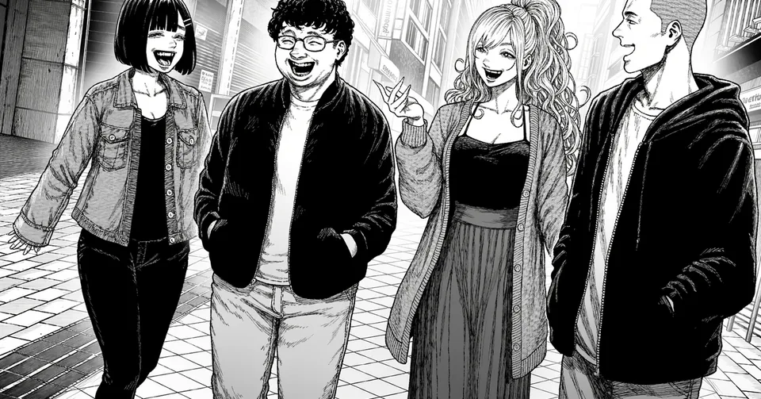
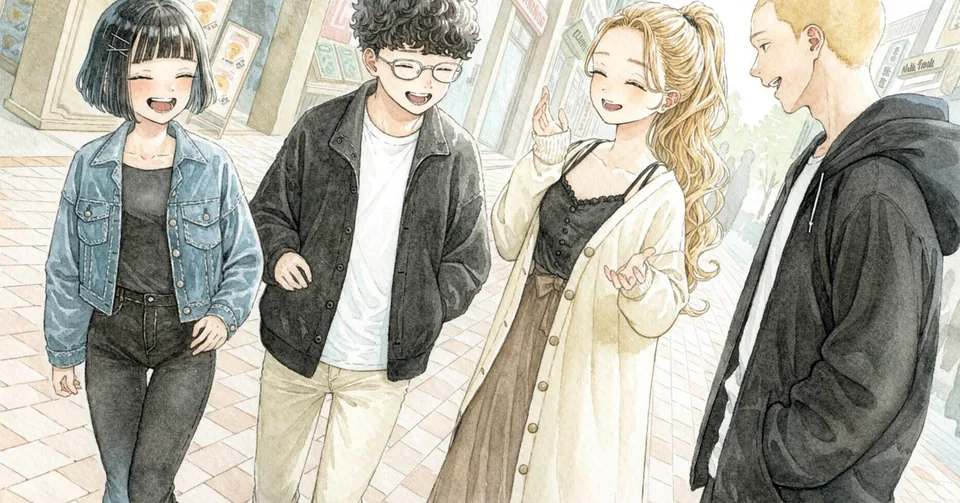
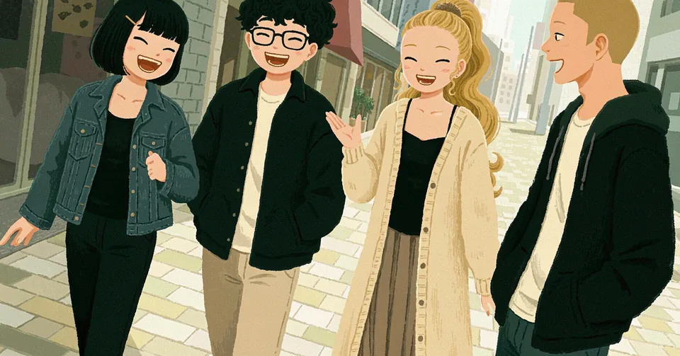
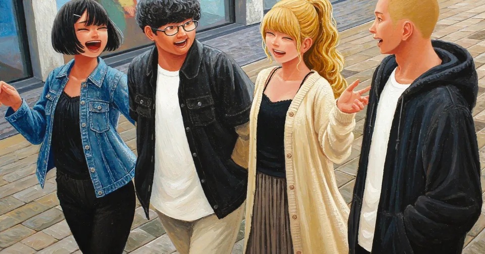
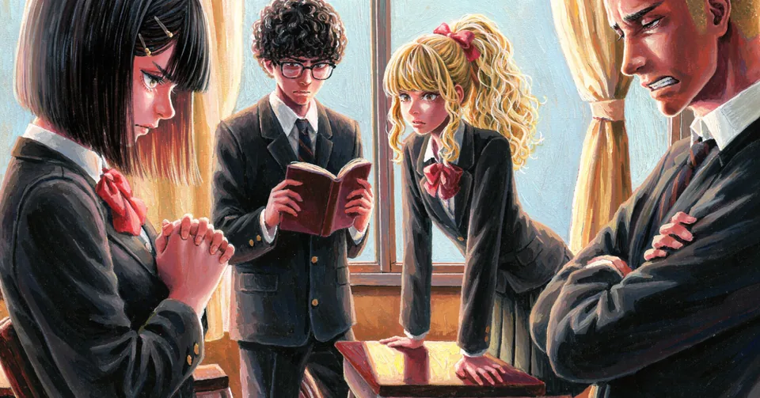
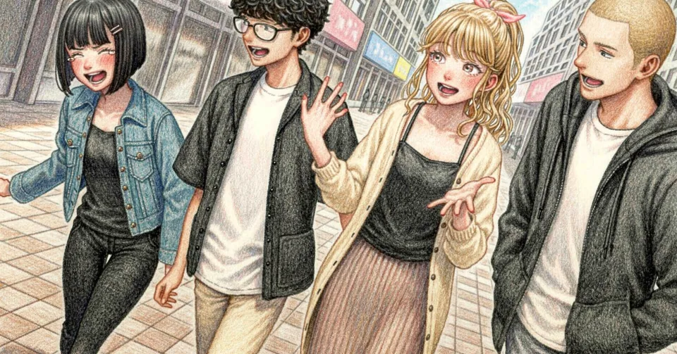
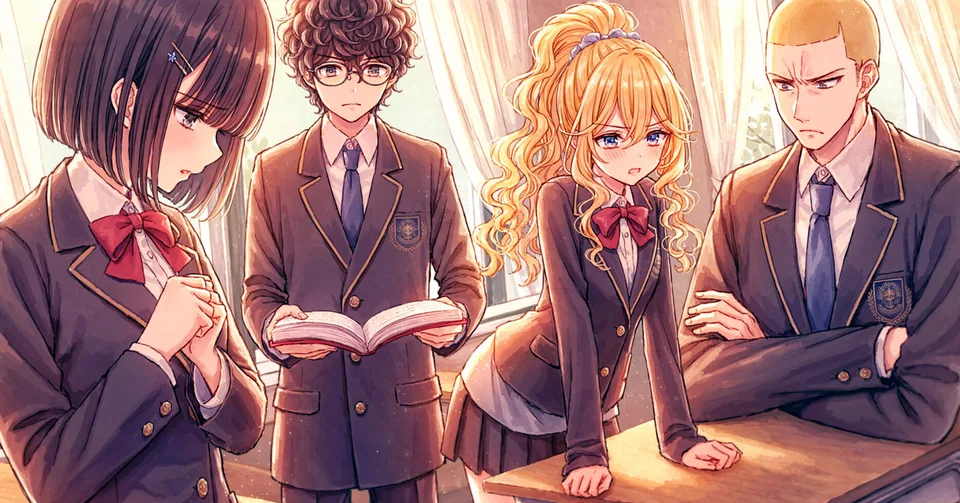
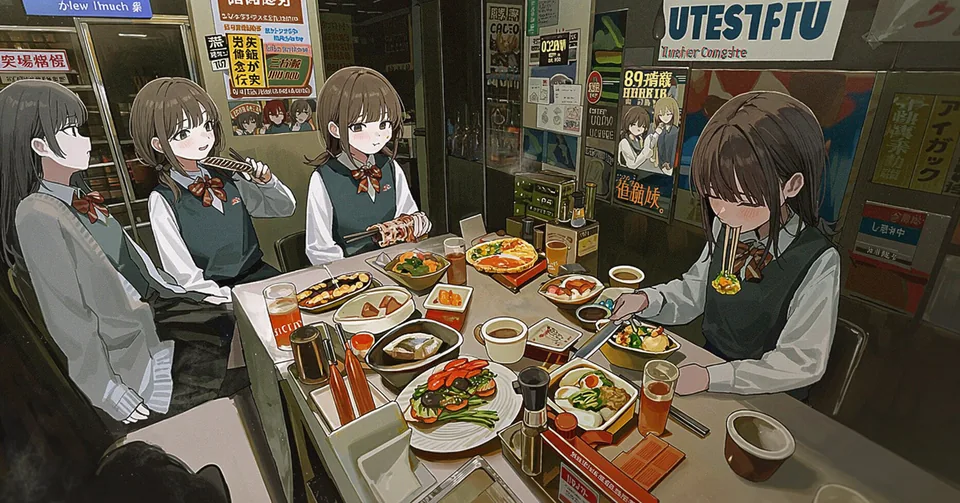
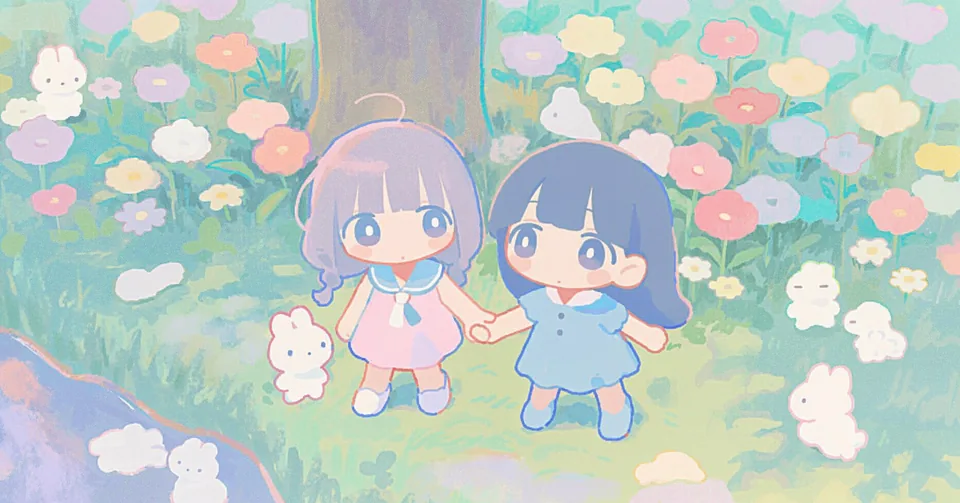

# 採用画風11候補・見本17枚

キット専用の見本です。選びたい画風ID（`style-01` 等）をお伝えください。

- 新規プロジェクトには見本画像をコピーしません。
- 画像を検索・絞り込みしながら見る場合は [index.html](index.html) を開いてください。元データは [catalog.json](catalog.json) です。

共通の生成条件：nai-diffusion-5-curated、1344×704px、steps 24、scale 5.5、sampler k_euler_ancestral。1回1枚・参照なし。生成日は各見本の説明を参照。

生成方法：`scripts/novelai_compose.py`（`--no-quality-tags --uc-preset none`、`--scale 5.5`）と `novelai_batch.py`。

## 目次

| 名前 | 画風ID | 見本ID |
| --- | --- | --- |
| [黒ベタ＋ハッチング / 街中](#style-01-street) | `style-01` | `style-01-street` |
| [黒ベタ＋ハッチング / 学校](#style-01-school) | `style-01` | `style-01-school` |
| [淡彩水彩＋ペン線 / 街中](#style-02-street) | `style-02` | `style-02-street` |
| [淡彩水彩＋ペン線 / 学校](#style-02-school) | `style-02` | `style-02-school` |
| [不透明ガッシュ / 街中](#style-03-street) | `style-03` | `style-03-street` |
| [不透明ガッシュ / 学校](#style-03-school) | `style-03` | `style-03-school` |
| [アクリル厚塗り / 街中](#style-04-street) | `style-04` | `style-04-street` |
| [アクリル厚塗り / 学校](#style-04-school) | `style-04` | `style-04-school` |
| [色鉛筆 / 街中](#style-05-street) | `style-05` | `style-05-street` |
| [色鉛筆 / 学校](#style-05-school) | `style-05` | `style-05-school` |
| [線画＋塗り込み / 街中](#style-06-street) | `style-06` | `style-06-street` |
| [線画＋塗り込み / 学校](#style-06-school) | `style-06` | `style-06-school` |
| [year 2025 / 女性2人・画風単体テスト](#style-07-two-girls) | `style-07` | `style-07-two-girls` |
| [デフォルメ・白い瞳孔・パステル / 女性2人・画風単体テスト](#style-08-two-girls) | `style-08` | `style-08-two-girls` |
| [かわいいカラー漫画 / 女性2人・画風単体テスト](#style-09-two-girls) | `style-09` | `style-09-two-girls` |
| [かわいいモノクロ漫画 / 女性2人・画風単体テスト](#style-10-two-girls) | `style-10` | `style-10-two-girls` |
| [鮮やかカラー・細線・大きな丸い目 / 女性2人・画風単体テスト](#style-11-two-girls) | `style-11` | `style-11-two-girls` |

---

## 黒ベタ＋ハッチング / 街中

<a id="style-01-street"></a>



- **画風ID**：`style-01`
- **見本ID**：`style-01-street`
- **説明**：男女4人・斜めの構図。同じ画風の2場面の参考で、長編での安定保証ではありません。V5 Curatedで2026-10-05に生成し直した見本（人物別入力と配置ピンを使用）。

<details>
<summary>指定プロンプト</summary>

```text
2girls, 2boys, walking along a shopping street, diagonal composition, dynamic angle, daylight, city shopping street, buildings, pavement, Monochrome black-and-white manga, gritty adventure art, variable-width dip-pen lines, large pure black ink masses, harsh white rim light, deep chiaroscuro, dense crosshatching, angular faces, realistic anatomy, white paper highlights.
人物1（配置ピン 0.15, 0.5）: girl, black bob cut hair with bangs, small hairclip, denim jacket over black top, black pants, walking, laughing, looking at the group
人物2（配置ピン 0.38, 0.5）: boy, short curly black hair, glasses, black jacket over white t-shirt, light pants, walking, talking, smiling
人物3（配置ピン 0.62, 0.5）: girl, long wavy light hair in a high ponytail, long cardigan over black camisole, long skirt, walking, smiling, gesturing with one hand
人物4（配置ピン 0.85, 0.5）: boy, tall, light buzz cut, black hooded jacket over white shirt, hands in pockets, walking, talking, looking at the group
除外: color, flat cel shading, airbrush
seed: 212100245
```

</details>

---

## 黒ベタ＋ハッチング / 学校

<a id="style-01-school"></a>


- **画風ID**：`style-01`
- **見本ID**：`style-01-school`
- **説明**：男女4人・斜めの構図。同じ画風の2場面の参考で、長編での安定保証ではありません。V5 Curatedで2026-10-05に生成し直した見本（人物別入力と配置ピンを使用）。

<details>
<summary>指定プロンプト</summary>

```text
2girls, 2boys, tense conversation in a classroom, diagonal composition, dynamic angle, daylight, classroom, desks, large windows, curtains, Monochrome black-and-white manga, gritty adventure art, variable-width dip-pen lines, large pure black ink masses, harsh white rim light, deep chiaroscuro, dense crosshatching, angular faces, realistic anatomy, white paper highlights.
人物1（配置ピン 0.15, 0.5）: girl, black bob cut hair with bangs, small hairclip, dark school blazer, white shirt, ribbon, standing with hands clasped, looking down, serious expression
人物2（配置ピン 0.38, 0.5）: boy, short curly black hair, glasses, dark school blazer, necktie, standing, holding an open book out, serious expression
人物3（配置ピン 0.62, 0.5）: girl, long wavy light hair in a high ponytail, school blazer, bow, pleated skirt, leaning on a desk with both hands, looking at the book
人物4（配置ピン 0.85, 0.5）: boy, tall, light buzz cut, school blazer, necktie, sitting at a desk, arms crossed, frowning
除外: color, flat cel shading, airbrush
seed: 811265767
```

</details>

---

## 淡彩水彩＋ペン線 / 街中

<a id="style-02-street"></a>



- **画風ID**：`style-02`
- **見本ID**：`style-02-street`
- **説明**：男女4人・斜めの構図。同じ画風の2場面の参考で、長編での安定保証ではありません。V5 Curatedで2026-10-05に生成し直した見本（人物別入力と配置ピンを使用）。

<details>
<summary>指定プロンプト</summary>

```text
2girls, 2boys, walking along a shopping street, diagonal composition, dynamic angle, daylight, city shopping street, buildings, pavement, Traditional watercolor illustration with delicate ink outlines, transparent pale watercolor washes, soft color bleeding at shadow edges, bright white paper reserves, subtle cold-press paper grain, fresh restrained pastel palette.
人物1（配置ピン 0.15, 0.5）: girl, black bob cut hair with bangs, small hairclip, denim jacket over black top, black pants, walking, laughing, looking at the group
人物2（配置ピン 0.38, 0.5）: boy, short curly black hair, glasses, black jacket over white t-shirt, light pants, walking, talking, smiling
人物3（配置ピン 0.62, 0.5）: girl, long wavy blonde hair in a high ponytail, long cream cardigan over black camisole, long skirt, walking, smiling, gesturing with one hand
人物4（配置ピン 0.85, 0.5）: boy, tall, blonde buzz cut, black hooded jacket over white shirt, hands in pockets, walking, talking, looking at the group
除外: thick opaque paint, flat cel shading, glossy 3d
seed: 3207191024
```

</details>

---

## 淡彩水彩＋ペン線 / 学校

<a id="style-02-school"></a>


- **画風ID**：`style-02`
- **見本ID**：`style-02-school`
- **説明**：男女4人・斜めの構図。同じ画風の2場面の参考で、長編での安定保証ではありません。V5 Curatedで2026-10-05に生成し直した見本（人物別入力と配置ピンを使用）。

<details>
<summary>指定プロンプト</summary>

```text
2girls, 2boys, tense conversation in a classroom, diagonal composition, dynamic angle, daylight, classroom, desks, large windows, curtains, Traditional watercolor illustration with delicate ink outlines, transparent pale watercolor washes, soft color bleeding at shadow edges, bright white paper reserves, subtle cold-press paper grain, fresh restrained pastel palette.
人物1（配置ピン 0.15, 0.5）: girl, black bob cut hair with bangs, small hairclip, dark school blazer, white shirt, ribbon, standing with hands clasped, looking down, serious expression
人物2（配置ピン 0.38, 0.5）: boy, short curly black hair, glasses, dark school blazer, necktie, standing, holding an open book out, serious expression
人物3（配置ピン 0.62, 0.5）: girl, long wavy blonde hair in a high ponytail, school blazer, bow, pleated skirt, leaning on a desk with both hands, looking at the book
人物4（配置ピン 0.85, 0.5）: boy, tall, blonde buzz cut, school blazer, necktie, sitting at a desk, arms crossed, frowning
除外: thick opaque paint, flat cel shading, glossy 3d
seed: 974616611
```

</details>

---

## 不透明ガッシュ / 街中

<a id="style-03-street"></a>



- **画風ID**：`style-03`
- **見本ID**：`style-03-street`
- **説明**：男女4人・斜めの構図。同じ画風の2場面の参考で、長編での安定保証ではありません。V5 Curatedで2026-10-05に生成し直した見本（人物別入力と配置ピンを使用）。

<details>
<summary>指定プロンプト</summary>

```text
2girls, 2boys, walking along a shopping street, diagonal composition, dynamic angle, daylight, city shopping street, buildings, pavement, Gouache illustration, opaque matte color planes, chalky painted highlights, subtle dry-brush texture, hand-painted edges, warm and cool muted color contrast, simplified strong shapes, lightly outlined expressive faces.
人物1（配置ピン 0.15, 0.5）: girl, black bob cut hair with bangs, small hairclip, denim jacket over black top, black pants, walking, laughing, looking at the group
人物2（配置ピン 0.38, 0.5）: boy, short curly black hair, glasses, black jacket over white t-shirt, light pants, walking, talking, smiling
人物3（配置ピン 0.62, 0.5）: girl, long wavy blonde hair in a high ponytail, long cream cardigan over black camisole, long skirt, walking, smiling, gesturing with one hand
人物4（配置ピン 0.85, 0.5）: boy, tall, blonde buzz cut, black hooded jacket over white shirt, hands in pockets, walking, talking, looking at the group
除外: glossy, transparent watercolor, airbrush
seed: 1976735317
```

</details>

---

## 不透明ガッシュ / 学校

<a id="style-03-school"></a>


- **画風ID**：`style-03`
- **見本ID**：`style-03-school`
- **説明**：男女4人・斜めの構図。同じ画風の2場面の参考で、長編での安定保証ではありません。V5 Curatedで2026-10-05に生成し直した見本（人物別入力と配置ピンを使用）。

<details>
<summary>指定プロンプト</summary>

```text
2girls, 2boys, tense conversation in a classroom, diagonal composition, dynamic angle, daylight, classroom, desks, large windows, curtains, Gouache illustration, opaque matte color planes, chalky painted highlights, subtle dry-brush texture, hand-painted edges, warm and cool muted color contrast, simplified strong shapes, lightly outlined expressive faces.
人物1（配置ピン 0.15, 0.5）: girl, black bob cut hair with bangs, small hairclip, dark school blazer, white shirt, ribbon, standing with hands clasped, looking down, serious expression
人物2（配置ピン 0.38, 0.5）: boy, short curly black hair, glasses, dark school blazer, necktie, standing, holding an open book out, serious expression
人物3（配置ピン 0.62, 0.5）: girl, long wavy blonde hair in a high ponytail, school blazer, bow, pleated skirt, leaning on a desk with both hands, looking at the book
人物4（配置ピン 0.85, 0.5）: boy, tall, blonde buzz cut, school blazer, necktie, sitting at a desk, arms crossed, frowning
除外: glossy, transparent watercolor, airbrush
seed: 2316200278
```

</details>

---

## アクリル厚塗り / 街中

<a id="style-04-street"></a>



- **画風ID**：`style-04`
- **見本ID**：`style-04-street`
- **説明**：男女4人・斜めの構図。同じ画風の2場面の参考で、長編での安定保証ではありません。V5 Curatedで2026-10-05に生成し直した見本（人物別入力と配置ピンを使用）。

<details>
<summary>指定プロンプト</summary>

```text
2girls, 2boys, walking along a shopping street, diagonal composition, dynamic angle, daylight, city shopping street, buildings, pavement, Acrylic painting, bold opaque brushstrokes, visible paint ridges, layered saturated colors, decisive angular strokes defining clothes and architecture, crisp focal faces, matte textured painted surfaces.
人物1（配置ピン 0.15, 0.5）: girl, black bob cut hair with bangs, small hairclip, denim jacket over black top, black pants, walking, laughing, looking at the group
人物2（配置ピン 0.38, 0.5）: boy, short curly black hair, glasses, black jacket over white t-shirt, light pants, walking, talking, smiling
人物3（配置ピン 0.62, 0.5）: girl, long wavy blonde hair in a high ponytail, long cream cardigan over black camisole, long skirt, walking, smiling, gesturing with one hand
人物4（配置ピン 0.85, 0.5）: boy, tall, blonde buzz cut, black hooded jacket over white shirt, hands in pockets, walking, talking, looking at the group
除外: flat cel shading, vector, thin ink outline
seed: 2057103239
```

</details>

---

## アクリル厚塗り / 学校

<a id="style-04-school"></a>



- **画風ID**：`style-04`
- **見本ID**：`style-04-school`
- **説明**：男女4人・斜めの構図。同じ画風の2場面の参考で、長編での安定保証ではありません。V5 Curatedで2026-10-05に生成し直した見本（人物別入力と配置ピンを使用）。

<details>
<summary>指定プロンプト</summary>

```text
2girls, 2boys, tense conversation in a classroom, diagonal composition, dynamic angle, daylight, classroom, desks, large windows, curtains, Acrylic painting, bold opaque brushstrokes, visible paint ridges, layered saturated colors, decisive angular strokes defining clothes and architecture, crisp focal faces, matte textured painted surfaces.
人物1（配置ピン 0.15, 0.5）: girl, black bob cut hair with bangs, small hairclip, dark school blazer, white shirt, ribbon, standing with hands clasped, looking down, serious expression
人物2（配置ピン 0.38, 0.5）: boy, short curly black hair, glasses, dark school blazer, necktie, standing, holding an open book out, serious expression
人物3（配置ピン 0.62, 0.5）: girl, long wavy blonde hair in a high ponytail, school blazer, bow, pleated skirt, leaning on a desk with both hands, looking at the book
人物4（配置ピン 0.85, 0.5）: boy, tall, blonde buzz cut, school blazer, necktie, sitting at a desk, arms crossed, frowning
除外: flat cel shading, vector, thin ink outline
seed: 1291358436
```

</details>

---

## 色鉛筆 / 街中

<a id="style-05-street"></a>



- **画風ID**：`style-05`
- **見本ID**：`style-05-street`
- **説明**：男女4人・斜めの構図。同じ画風の2場面の参考で、長編での安定保証ではありません。V5 Curatedで2026-10-05に生成し直した見本（人物別入力と配置ピンを使用）。

<details>
<summary>指定プロンプト</summary>

```text
2girls, 2boys, walking along a shopping street, diagonal composition, dynamic angle, daylight, city shopping street, buildings, pavement, Colored pencil illustration, visible fine colored hatching, layered translucent pencil colors, textured ivory paper, delicate dark pencil contours, detailed expressive faces, softly shaded dimensional clothes.
人物1（配置ピン 0.15, 0.5）: girl, black bob cut hair with bangs, small hairclip, denim jacket over black top, black pants, walking, laughing, looking at the group
人物2（配置ピン 0.38, 0.5）: boy, short curly black hair, glasses, black jacket over white t-shirt, light pants, walking, talking, smiling
人物3（配置ピン 0.62, 0.5）: girl, long wavy blonde hair in a high ponytail, long cream cardigan over black camisole, long skirt, walking, smiling, gesturing with one hand
人物4（配置ピン 0.85, 0.5）: boy, tall, blonde buzz cut, black hooded jacket over white shirt, hands in pockets, walking, talking, looking at the group
除外: glossy, flat digital fills, thick paint
seed: 2053534655
```

</details>

---

## 色鉛筆 / 学校

<a id="style-05-school"></a>


- **画風ID**：`style-05`
- **見本ID**：`style-05-school`
- **説明**：男女4人・斜めの構図。同じ画風の2場面の参考で、長編での安定保証ではありません。V5 Curatedで2026-10-05に生成し直した見本（人物別入力と配置ピンを使用）。

<details>
<summary>指定プロンプト</summary>

```text
2girls, 2boys, tense conversation in a classroom, diagonal composition, dynamic angle, daylight, classroom, desks, large windows, curtains, Colored pencil illustration, visible fine colored hatching, layered translucent pencil colors, textured ivory paper, delicate dark pencil contours, detailed expressive faces, softly shaded dimensional clothes.
人物1（配置ピン 0.15, 0.5）: girl, black bob cut hair with bangs, small hairclip, dark school blazer, white shirt, ribbon, standing with hands clasped, looking down, serious expression
人物2（配置ピン 0.38, 0.5）: boy, short curly black hair, glasses, dark school blazer, necktie, standing, holding an open book out, serious expression
人物3（配置ピン 0.62, 0.5）: girl, long wavy blonde hair in a high ponytail, school blazer, bow, pleated skirt, leaning on a desk with both hands, looking at the book
人物4（配置ピン 0.85, 0.5）: boy, tall, blonde buzz cut, school blazer, necktie, sitting at a desk, arms crossed, frowning
除外: glossy, flat digital fills, thick paint
seed: 1515160439
```

</details>

---

## 線画＋塗り込み / 街中

<a id="style-06-street"></a>


- **画風ID**：`style-06`
- **見本ID**：`style-06-street`
- **説明**：男女4人・斜めの構図。同じ画風の2場面の参考で、長編での安定保証ではありません。V5 Curatedで2026-10-05に生成し直した見本（人物別入力と配置ピンを使用）。

<details>
<summary>指定プロンプト</summary>

```text
2girls, 2boys, walking along a shopping street, diagonal composition, dynamic angle, daylight, city shopping street, buildings, pavement, Detailed painted anime illustration, expressive fine lineart blended with painterly shading, soft reflected light, layered warm and cool shadows, textured but controlled brushwork, sharp facial features and focal edges.
人物1（配置ピン 0.15, 0.5）: girl, black bob cut hair with bangs, small hairclip, denim jacket over black top, black pants, walking, laughing, looking at the group
人物2（配置ピン 0.38, 0.5）: boy, short curly black hair, glasses, black jacket over white t-shirt, light pants, walking, talking, smiling
人物3（配置ピン 0.62, 0.5）: girl, long wavy blonde hair in a high ponytail, long cream cardigan over black camisole, long skirt, walking, smiling, gesturing with one hand
人物4（配置ピン 0.85, 0.5）: boy, tall, blonde buzz cut, black hooded jacket over white shirt, hands in pockets, walking, talking, looking at the group
除外: flat vector, heavy halftone, photorealistic skin
seed: 628799543
```

</details>

---

## 線画＋塗り込み / 学校

<a id="style-06-school"></a>



- **画風ID**：`style-06`
- **見本ID**：`style-06-school`
- **説明**：男女4人・斜めの構図。同じ画風の2場面の参考で、長編での安定保証ではありません。V5 Curatedで2026-10-05に生成し直した見本（人物別入力と配置ピンを使用）。

<details>
<summary>指定プロンプト</summary>

```text
2girls, 2boys, tense conversation in a classroom, diagonal composition, dynamic angle, daylight, classroom, desks, large windows, curtains, Detailed painted anime illustration, expressive fine lineart blended with painterly shading, soft reflected light, layered warm and cool shadows, textured but controlled brushwork, sharp facial features and focal edges.
人物1（配置ピン 0.15, 0.5）: girl, black bob cut hair with bangs, small hairclip, dark school blazer, white shirt, ribbon, standing with hands clasped, looking down, serious expression
人物2（配置ピン 0.38, 0.5）: boy, short curly black hair, glasses, dark school blazer, necktie, standing, holding an open book out, serious expression
人物3（配置ピン 0.62, 0.5）: girl, long wavy blonde hair in a high ponytail, school blazer, bow, pleated skirt, leaning on a desk with both hands, looking at the book
人物4（配置ピン 0.85, 0.5）: boy, tall, blonde buzz cut, school blazer, necktie, sitting at a desk, arms crossed, frowning
除外: flat vector, heavy halftone, photorealistic skin
seed: 3264575205
```

</details>

---

## year 2025 / 女性2人・画風単体テスト

<a id="style-07-two-girls"></a>



- **画風ID**：`style-07`
- **見本ID**：`style-07-two-girls`
- **説明**：女性2人・画風単体テスト。画風文以外の場面指定はなく、同じseed 91001でも画像ごとに場面が異なります。V5 Curatedで2026-10-05に生成し直した見本で、画風だけの比較ではありません。

<details>
<summary>指定プロンプト</summary>

```text
2girls, multiple girls, year 2025
除外: nsfw, nudity, sexualized pose, explicit, text, watermark, signature, logo
seed: 91001
```

</details>

---

## デフォルメ・白い瞳孔・パステル / 女性2人・画風単体テスト

<a id="style-08-two-girls"></a>



- **画風ID**：`style-08`
- **見本ID**：`style-08-two-girls`
- **説明**：女性2人・画風単体テスト。画風文以外の場面指定はなく、同じseed 91001でも画像ごとに場面が異なります。V5 Curatedで2026-10-05に生成し直した見本で、画風だけの比較ではありません。

<details>
<summary>指定プロンプト</summary>

```text
2girls, multiple girls, deformed, white pupils, colored lineart, painterly, soft style, pastel colors, year 2025
除外: nsfw, nudity, sexualized pose, explicit, text, watermark, signature, logo
seed: 91001
```

</details>

---

## かわいいカラー漫画 / 女性2人・画風単体テスト

<a id="style-09-two-girls"></a>


- **画風ID**：`style-09`
- **見本ID**：`style-09-two-girls`
- **説明**：女性2人・画風単体テスト。画風文以外の場面指定はなく、同じseed 91001でも画像ごとに場面が異なります。V5 Curatedで2026-10-05に生成し直した見本で、画風だけの比較ではありません。

<details>
<summary>指定プロンプト</summary>

```text
2girls, multiple girls, cute manga style, pastel colors, anime coloring, delicate lineart, thin lines, colored outlines, rounded faces, large expressive eyes, small noses, small mouths, slightly oversized heads, simplified proportions, light cel shading, subtle highlights, bright gentle colors
除外: nsfw, nudity, sexualized pose, explicit, text, watermark, signature, logo
seed: 91001
```

</details>

---

## かわいいモノクロ漫画 / 女性2人・画風単体テスト

<a id="style-10-two-girls"></a>


- **画風ID**：`style-10`
- **見本ID**：`style-10-two-girls`
- **説明**：女性2人・画風単体テスト。画風文以外の場面指定はなく、同じseed 91001でも画像ごとに場面が異なります。V5 Curatedで2026-10-05に生成し直した見本で、画風だけの比較ではありません。

<details>
<summary>指定プロンプト</summary>

```text
2girls, multiple girls, monochrome, greyscale, cute manga style, delicate lineart, thin lines, rounded faces, large expressive eyes, small noses, small mouths, slightly oversized heads, simplified proportions, light screentones, minimal solid blacks, light shading
除外: nsfw, nudity, sexualized pose, explicit, text, watermark, signature, logo
seed: 91001
```

</details>

---

## 鮮やかカラー・細線・大きな丸い目 / 女性2人・画風単体テスト

<a id="style-11-two-girls"></a>


- **画風ID**：`style-11`
- **見本ID**：`style-11-two-girls`
- **説明**：追加指定の女性2人・同じseed 91001の画風単体テスト。画風文以外の場面指定はなく、同じseedでも画像ごとに場面が異なります（この画像は4人が描かれました）。V5 Curatedで2026-10-06に生成。他の見本と違い、品質タグ（very aesthetic, no text。masterpieceは画風文と重複のため追加なし）と除外プリセット（Heavy）はスクリプトの既定です。

<details>
<summary>指定プロンプト</summary>

```text
2girls, multiple girls, masterpiece, best quality, highly detailed,vivid colors, saturated,thin lines, clean lineart,digital art, clean coloring,large eyes, round eyes,, very aesthetic, no text
除外: lowres, artistic error, film grain, scan artifacts, worst quality, bad quality, jpeg artifacts, very displeasing, chromatic aberration, dithering, halftone, screentone, multiple views, logo, too many watermarks, negative space, blank page
seed: 91001
```

</details>
