# PixAIのモデル15種・画風プリセット35種

キット専用の見本です。使いたいモデルの名前（`tsubaki2` 等）や画風プリセットの名前（`paper-watercolor` 等）をお伝えください。

- 基本的に同じプロンプト「1girl, solo, cat ears, serafuku, park」とseedで生成しています。
- モデルの見本は画風プリセットなし、画風プリセットの見本は Tsubaki.2（mode standard）にプリセットだけを足したものです。
- 1枚ずつの比較なので、安定した傾向の保証ではありません。
- 新規プロジェクトには見本画像をコピーしません。
- 画像を検索・絞り込みしながら見る場合は [index.html](index.html) を開いてください。元データは [catalog.json](catalog.json) です。

共通の生成条件：v2・2:3・1k（848×1280px）、seed 20261025、キットの既定の組み立て（`pixai_compose.py`）、2026-10-25生成。

## 目次

| 名前 | 種類 | 指定 |
| --- | --- | --- |
| [Tsubaki.3](#tsubaki3) | DiT | `--model tsubaki3` |
| [Tsubaki.3 Flash](#tsubaki3-flash) | DiT | `--model tsubaki3-flash` |
| [Tsubaki.2](#tsubaki2) | DiT | `--model tsubaki2`（キットの既定） |
| [Tsubaki](#tsubaki) | DiT | `--model tsubaki` |
| [Tsubaki v1.1](#tsubaki-v11) | DiT | `--model tsubaki-v1-1` |
| [Tsubaki Flash](#tsubaki-flash) | DiT | `--model tsubaki-flash` |
| [Serin](#serin) | DiT | `--model serin` |
| [Haruka v2](#haruka-v2) | SDXL | `--model haruka2` |
| [Haruka](#haruka) | SDXL | `--model haruka` |
| [Hoshino v2](#hoshino-v2) | SDXL | `--model hoshino2` |
| [Otome v2](#otome-v2) | SDXL | `--model otome2` |
| [Hinata v2](#hinata-v2) | SDXL | `--model hinata2` |
| [Nagi](#nagi) | SDXL | `--model nagi` |
| [Crystalize](#crystalize) | SDXL | `--model crystalize` |
| [Eternal](#eternal) | SDXL | `--model eternal` |
| [Watercolor Glow](#watercolor-glowanime-watercolor-impasto) | 画風プリセット | `--style-preset anime-watercolor-impasto` |
| [Art Crayon](#art-crayonart-crayon) | 画風プリセット | `--style-preset art-crayon` |
| [Glint & Gloom](#glint--gloombold-line-soft-color) | 画風プリセット | `--style-preset bold-line-soft-color` |
| [Chibi](#chibichibi) | 画風プリセット | `--style-preset chibi` |
| [Classic Anime](#classic-animeclassic-japanese) | 画風プリセット | `--style-preset classic-japanese` |
| [Clean Flat-Illustration](#clean-flat-illustrationclean-flat-illustration) | 画風プリセット | `--style-preset clean-flat-illustration` |
| [Chromatic Pencil](#chromatic-pencilcolored-pencil-grain) | 画風プリセット | `--style-preset colored-pencil-grain` |
| [Seasonal Glow](#seasonal-glowcool-warm-oil-contrast) | 画風プリセット | `--style-preset cool-warm-oil-contrast` |
| [Cool Softlight](#cool-softlightdesaturated-cool) | 画風プリセット | `--style-preset desaturated-cool` |
| [Pastel Flat](#pastel-flatflat-anime-pastel) | 画風プリセット | `--style-preset flat-anime-pastel` |
| [Glassy Anime](#glassy-animeglossy-glass-anime) | 画風プリセット | `--style-preset glossy-glass-anime` |
| [Grey Wash](#grey-washgrey-blocks-lineless) | 画風プリセット | `--style-preset grey-blocks-lineless` |
| [Sharp Ink](#sharp-inkhard-line-monochrome-accent) | 画風プリセット | `--style-preset hard-line-monochrome-accent` |
| [Neon Vivid](#neon-vividhigh-contrast-retro-vivid) | 画風プリセット | `--style-preset high-contrast-retro-vivid` |
| [Hyper Pop](#hyper-popholographic) | 画風プリセット | `--style-preset holographic` |
| [Polished Manhwa](#polished-manhwakorean-style) | 画風プリセット | `--style-preset korean-style` |
| [Luminous Wash](#luminous-washlineart-watercolor-airy) | 画風プリセット | `--style-preset lineart-watercolor-airy` |
| [Muted & Transparent](#muted--transparentlow-saturation-expressive-eyes) | 画風プリセット | `--style-preset low-saturation-expressive-eyes` |
| [Lucid Dreamy](#lucid-dreamylucid-dreamy) | 画風プリセット | `--style-preset lucid-dreamy` |
| [Luminous Impasto](#luminous-impastoluminous-retro-impasto) | 画風プリセット | `--style-preset luminous-retro-impasto` |
| [Minimal Flat](#minimal-flatminimal-flat-color) | 画風プリセット | `--style-preset minimal-flat-color` |
| [Modern Glam Anime](#modern-glam-animemodern-oil-glamour) | 画風プリセット | `--style-preset modern-oil-glamour` |
| [Moe Pastel](#moe-pastelmoe-pastel) | 画風プリセット | `--style-preset moe-pastel` |
| [Water-Infused Oil](#water-infused-oiloil-watercolor-blend) | 画風プリセット | `--style-preset oil-watercolor-blend` |
| [Tender Brushstroke](#tender-brushstrokepainterly-doodle) | 画風プリセット | `--style-preset painterly-doodle` |
| [Soft Aqueous](#soft-aqueouspaper-watercolor) | 画風プリセット | `--style-preset paper-watercolor` |
| [Pencil Sketch](#pencil-sketchpencil-sketch) | 画風プリセット | `--style-preset pencil-sketch` |
| [Neon Poster](#neon-posterposter-graffiti) | 画風プリセット | `--style-preset poster-graffiti` |
| [Retro Fusion](#retro-fusionretro-comic-fusion) | 画風プリセット | `--style-preset retro-comic-fusion` |
| [Retro Glam Anime](#retro-glam-animeretro-oil-glamour) | 画風プリセット | `--style-preset retro-oil-glamour` |
| [90s Retro-Cell](#90s-retro-cellretro-tv-anime) | 画風プリセット | `--style-preset retro-tv-anime` |
| [Semi-Real](#semi-realsemi-realistic) | 画風プリセット | `--style-preset semi-realistic` |
| [Neon Vaporwave](#neon-vaporwavestable-vaporwave) | 画風プリセット | `--style-preset stable-vaporwave` |
| [Tinted Sketch](#tinted-sketchtinted-sketch) | 画風プリセット | `--style-preset tinted-sketch` |
| [Vintage Collage](#vintage-collagevintage-collage) | 画風プリセット | `--style-preset vintage-collage` |

---

## Tsubaki.3

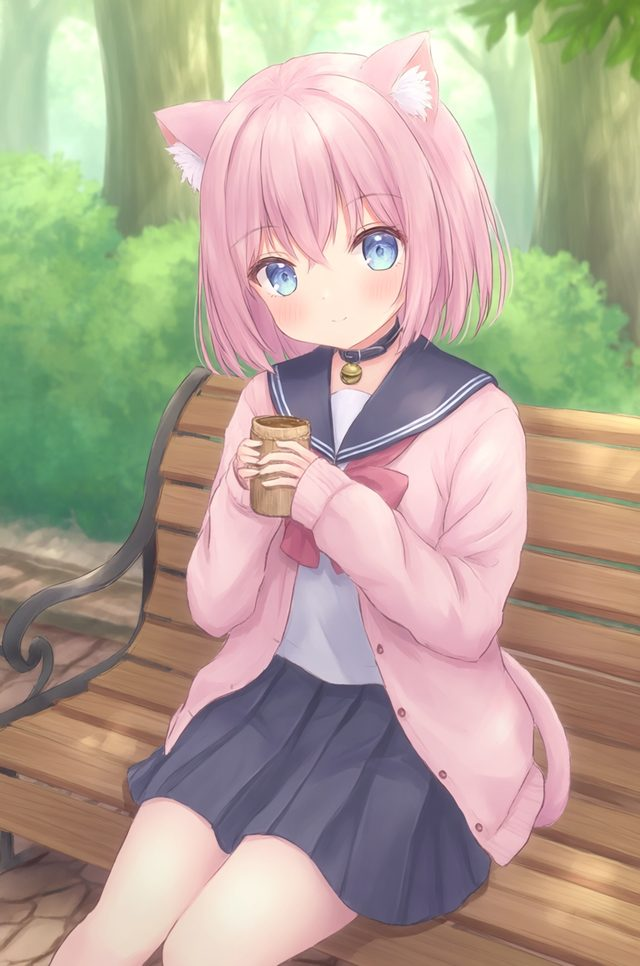

- **特徴**：最新の公式DiT。色の制御・プロンプトへの追従。pro は１枚1分以上かかる
- **見た目**：ピンクの髪・ベンチに座る。柔らかい明るい塗り
- **種類**：DiT（MMDIT26B_MODEL）
- **mode**：pro
- **生成時間**：1分以上
- **指定**：`--model tsubaki3` / modelVersionId `2024383379556065549`

<details>
<summary>指定プロンプト</summary>

```text
1girl, solo, cat ears, serafuku, park, masterpiece, best quality
除外: text, speech bubble, panel border, watermark
seed: 20261025
mode: pro
```

</details>

---

## Tsubaki.3 Flash

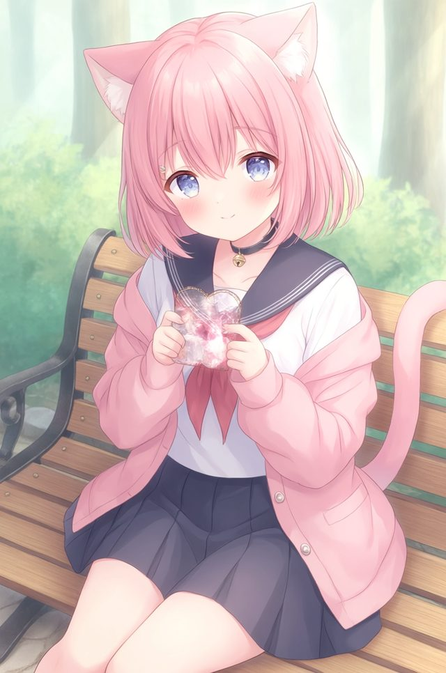

- **特徴**：Tsubaki.3 の高速版（8ステップ）。モデルページでは除外（negativePrompt）に非対応と表示
- **見た目**：Tsubaki.3 とほぼ同じ構図・塗り
- **種類**：DiT（MMDIT26B_MODEL）
- **mode**：なし
- **生成時間**：約41秒
- **指定**：`--model tsubaki3-flash` / modelVersionId `2050048243034896798`

<details>
<summary>指定プロンプト</summary>

```text
1girl, solo, cat ears, serafuku, park, masterpiece, best quality
除外: （なし）
seed: 20261025
```

</details>

---

## Tsubaki.2


- **特徴**：公式の推奨。複数人物・照明・動きのあるポーズ・プロンプトへの追従。キットの既定
- **見た目**：ピンクの髪・ほおづえのアップ。明るいアニメ塗り
- **種類**：DiT（MMDIT26A_MODEL）
- **mode**：standard
- **生成時間**：約21秒
- **指定**：`--model tsubaki2` / modelVersionId `1983308862240288769`

<details>
<summary>指定プロンプト</summary>

```text
1girl, solo, cat ears, serafuku, park, masterpiece, best quality
除外: text, speech bubble, panel border, watermark
seed: 20261025
mode: standard
```

</details>

---

## Tsubaki


- **特徴**：初代のDiT。複数人物・自然文のプロンプト。mode・画風プリセットは公式に Tsubaki.2・Tsubaki.3 系だけ
- **見た目**：黒髪・逆光の階段で振り返る全身。背景は公園より街路に近い
- **種類**：DiT（DIT7B_MODEL）
- **mode**：なし
- **生成時間**：約72秒
- **指定**：`--model tsubaki` / modelVersionId `1894092844569363483`

<details>
<summary>指定プロンプト</summary>

```text
1girl, solo, cat ears, serafuku, park, masterpiece, best quality
除外: text, speech bubble, panel border, watermark
seed: 20261025
```

</details>

---

## Tsubaki v1.1


- **特徴**：Tsubaki の改良版。高解像度・複数人物
- **見た目**：白髪・落ち着いた色の上半身。背景の公園はほぼ出なかった
- **種類**：DiT（DIT7B_MODEL）
- **mode**：なし
- **生成時間**：約30秒
- **指定**：`--model tsubaki-v1-1` / modelVersionId `1935090615918113018`

<details>
<summary>指定プロンプト</summary>

```text
1girl, solo, cat ears, serafuku, park, masterpiece, best quality
除外: text, speech bubble, panel border, watermark
seed: 20261025
```

</details>

---

## Tsubaki Flash


- **特徴**：Tsubaki の高速版
- **見た目**：長い黒髪・花と階段と建物。背景は公園より街並み
- **種類**：DiT（DIT7B_MODEL）
- **mode**：なし
- **生成時間**：約41秒
- **指定**：`--model tsubaki-flash` / modelVersionId `1934789864939078594`

<details>
<summary>指定プロンプト</summary>

```text
1girl, solo, cat ears, serafuku, park, masterpiece, best quality
除外: text, speech bubble, panel border, watermark
seed: 20261025
```

</details>

---

## Serin


- **特徴**：韓国のウェブトゥーン・ファッション風
- **見た目**：写実寄りの顔・夕方の街路。背景の公園は出なかった
- **種類**：DiT（DIT7B_MODEL）
- **mode**：なし
- **生成時間**：約30秒
- **指定**：`--model serin` / modelVersionId `1914519679917387494`

<details>
<summary>指定プロンプト</summary>

```text
1girl, solo, cat ears, serafuku, park, masterpiece, best quality
除外: text, speech bubble, panel border, watermark
seed: 20261025
```

</details>

---

## Haruka v2


- **特徴**：公式の推奨。安定した塗り・正確な手・高解像度。利用回数が最も多い
- **見た目**：黒髪・並木の公園。くっきりしたアニメ塗り
- **種類**：SDXL（SDXL_MODEL）
- **mode**：なし
- **生成時間**：約51秒
- **指定**：`--model haruka2` / modelVersionId `1861558740588989558`

<details>
<summary>指定プロンプト</summary>

```text
1girl, solo, cat ears, serafuku, park, masterpiece, best quality
除外: text, speech bubble, panel border, watermark
seed: 20261025
```

</details>

---

## Haruka

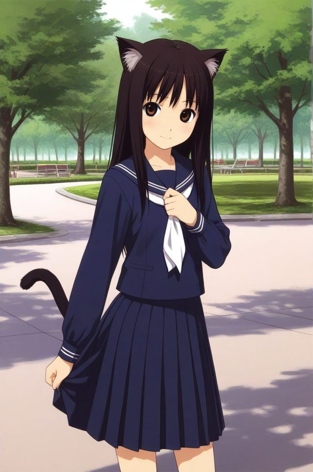

- **特徴**：Haruka v2 の前の版
- **見た目**：黒髪・並木の公園。平坦なアニメ塗り
- **種類**：SDXL（SDXL_MODEL）
- **mode**：なし
- **生成時間**：約15秒
- **指定**：`--model haruka` / modelVersionId `1805666669332128958`

<details>
<summary>指定プロンプト</summary>

```text
1girl, solo, cat ears, serafuku, park, masterpiece, best quality
除外: text, speech bubble, panel border, watermark
seed: 20261025
```

</details>

---

## Hoshino v2


- **特徴**：公式の推奨。日本で人気の作風・レトロなアニメ調・正確な手
- **見た目**：黒髪・並木の公園・学生かばん。くっきりしたアニメ塗り
- **種類**：SDXL（SDXL_MODEL）
- **mode**：なし
- **生成時間**：約21秒
- **指定**：`--model hoshino2` / modelVersionId `1954632828118619567`

<details>
<summary>指定プロンプト</summary>

```text
1girl, solo, cat ears, serafuku, park, masterpiece, best quality
除外: text, speech bubble, panel border, watermark
seed: 20261025
```

</details>

---

## Otome v2

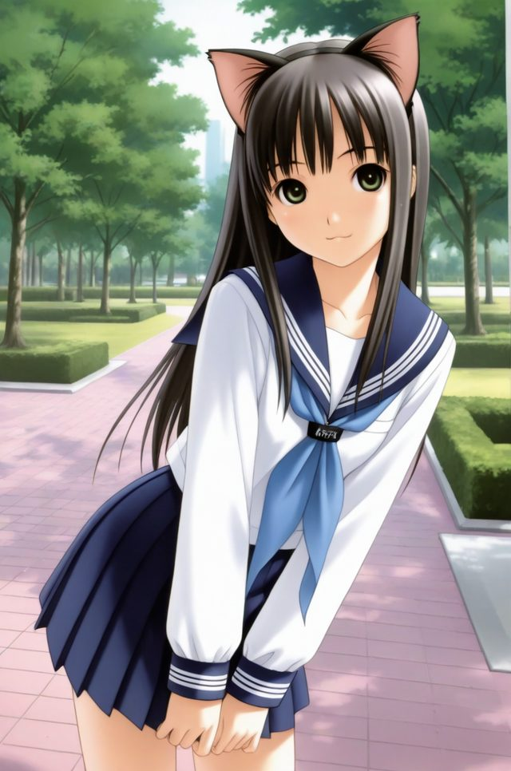

- **特徴**：男性キャラクター向け
- **見た目**：黒髪・並木の公園。やや古めのアニメ調
- **種類**：SDXL（SDXL_MODEL）
- **mode**：なし
- **生成時間**：約41秒
- **指定**：`--model otome2` / modelVersionId `1856956435031440023`

<details>
<summary>指定プロンプト</summary>

```text
1girl, solo, cat ears, serafuku, park, masterpiece, best quality
除外: text, speech bubble, panel border, watermark
seed: 20261025
```

</details>

---

## Hinata v2

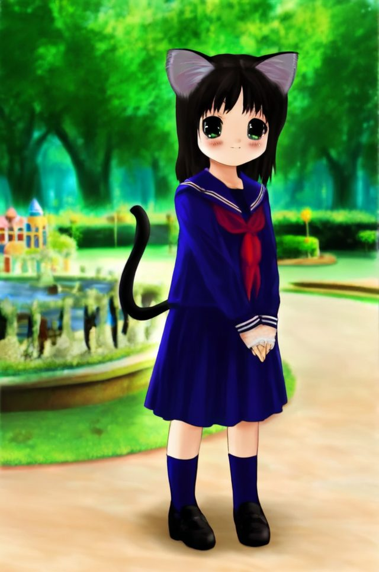

- **特徴**：画風の再現・短いプロンプト向け
- **見た目**：デフォルメ寄りの頭身・遊具のある公園。背景がにじんだ塗り
- **種類**：SDXL（SDXL_MODEL）
- **mode**：なし
- **生成時間**：約30秒
- **指定**：`--model hinata2` / modelVersionId `1869108561160475178`

<details>
<summary>指定プロンプト</summary>

```text
1girl, solo, cat ears, serafuku, park, masterpiece, best quality
除外: text, speech bubble, panel border, watermark
seed: 20261025
```

</details>

---

## Nagi

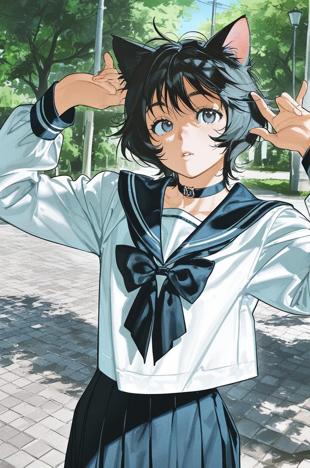

- **特徴**：画風の再現向け
- **見た目**：短めの黒髪・猫のポーズ。濃い線のイラスト調
- **種類**：SDXL（SDXL_MODEL）
- **mode**：なし
- **生成時間**：約30秒
- **指定**：`--model nagi` / modelVersionId `1961253301321929990`

<details>
<summary>指定プロンプト</summary>

```text
1girl, solo, cat ears, serafuku, park, masterpiece, best quality
除外: text, speech bubble, panel border, watermark
seed: 20261025
```

</details>

---

## Crystalize

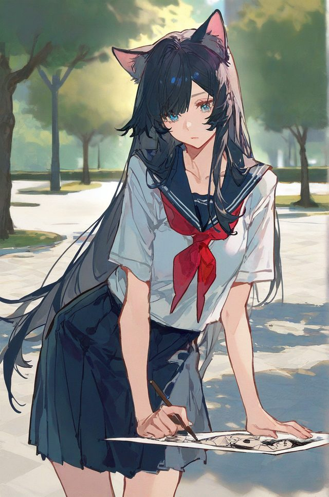

- **特徴**：画風の再現向け
- **見た目**：黒髪・机に手をつく。線の目立つイラスト調
- **種類**：SDXL（SDXL_MODEL）
- **mode**：なし
- **生成時間**：約71秒
- **指定**：`--model crystalize` / modelVersionId `1964824608626653146`

<details>
<summary>指定プロンプト</summary>

```text
1girl, solo, cat ears, serafuku, park, masterpiece, best quality
除外: text, speech bubble, panel border, watermark
seed: 20261025
```

</details>

---

## Eternal

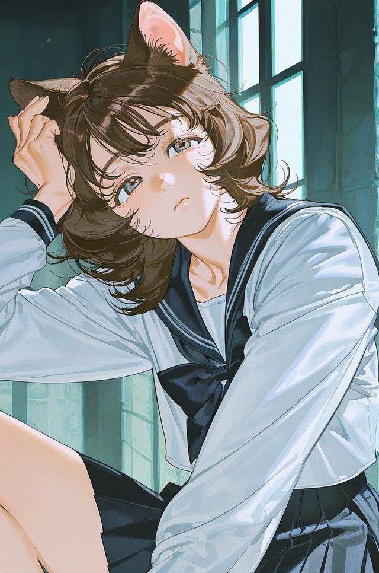

- **特徴**：画風の再現向け
- **見た目**：茶髪・窓のある室内風。背景の公園は出なかった。厚めの塗り
- **種類**：SDXL（SDXL_MODEL）
- **mode**：なし
- **生成時間**：約41秒
- **指定**：`--model eternal` / modelVersionId `1965302325944495788`

<details>
<summary>指定プロンプト</summary>

```text
1girl, solo, cat ears, serafuku, park, masterpiece, best quality
除外: text, speech bubble, panel border, watermark
seed: 20261025
```

</details>

---

## Watercolor Glow（anime-watercolor-impasto）


- **種類**：画風プリセット（Tsubaki.2・Tsubaki.3 系だけで有効）
- **見本のモデル**：Tsubaki.2
- **mode**：standard
- **指定**：`--style-preset anime-watercolor-impasto`（`--model tsubaki2`・`tsubaki3` 等と組み合わせる）

<details>
<summary>指定プロンプト</summary>

```text
1girl, solo, cat ears, serafuku, park, masterpiece, best quality
除外: text, speech bubble, panel border, watermark
seed: 20261025
mode: standard
```

</details>

---

## Art Crayon（art-crayon）


- **種類**：画風プリセット（Tsubaki.2・Tsubaki.3 系だけで有効）
- **見本のモデル**：Tsubaki.2
- **mode**：standard
- **指定**：`--style-preset art-crayon`（`--model tsubaki2`・`tsubaki3` 等と組み合わせる）

<details>
<summary>指定プロンプト</summary>

```text
1girl, solo, cat ears, serafuku, park, masterpiece, best quality
除外: text, speech bubble, panel border, watermark
seed: 20261025
mode: standard
```

</details>

---

## Glint & Gloom（bold-line-soft-color）


- **種類**：画風プリセット（Tsubaki.2・Tsubaki.3 系だけで有効）
- **見本のモデル**：Tsubaki.2
- **mode**：standard
- **指定**：`--style-preset bold-line-soft-color`（`--model tsubaki2`・`tsubaki3` 等と組み合わせる）

<details>
<summary>指定プロンプト</summary>

```text
1girl, solo, cat ears, serafuku, park, masterpiece, best quality
除外: text, speech bubble, panel border, watermark
seed: 20261025
mode: standard
```

</details>

---

## Chibi（chibi）

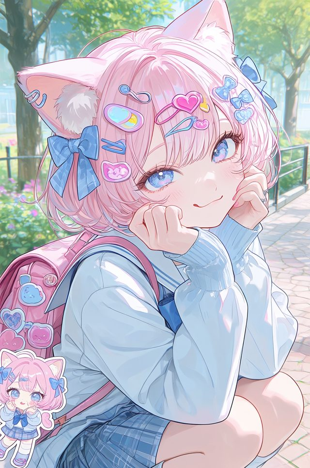

- **種類**：画風プリセット（Tsubaki.2・Tsubaki.3 系だけで有効）
- **見本のモデル**：Tsubaki.2
- **mode**：standard
- **指定**：`--style-preset chibi`（`--model tsubaki2`・`tsubaki3` 等と組み合わせる）

<details>
<summary>指定プロンプト</summary>

```text
1girl, solo, cat ears, serafuku, park, masterpiece, best quality
除外: text, speech bubble, panel border, watermark
seed: 20261025
mode: standard
```

</details>

---

## Classic Anime（classic-japanese）


- **種類**：画風プリセット（Tsubaki.2・Tsubaki.3 系だけで有効）
- **見本のモデル**：Tsubaki.2
- **mode**：standard
- **指定**：`--style-preset classic-japanese`（`--model tsubaki2`・`tsubaki3` 等と組み合わせる）

<details>
<summary>指定プロンプト</summary>

```text
1girl, solo, cat ears, serafuku, park, masterpiece, best quality
除外: text, speech bubble, panel border, watermark
seed: 20261025
mode: standard
```

</details>

---

## Clean Flat-Illustration（clean-flat-illustration）


- **種類**：画風プリセット（Tsubaki.2・Tsubaki.3 系だけで有効）
- **見本のモデル**：Tsubaki.2
- **mode**：standard
- **指定**：`--style-preset clean-flat-illustration`（`--model tsubaki2`・`tsubaki3` 等と組み合わせる）

<details>
<summary>指定プロンプト</summary>

```text
1girl, solo, cat ears, serafuku, park, masterpiece, best quality
除外: text, speech bubble, panel border, watermark
seed: 20261025
mode: standard
```

</details>

---

## Chromatic Pencil（colored-pencil-grain）

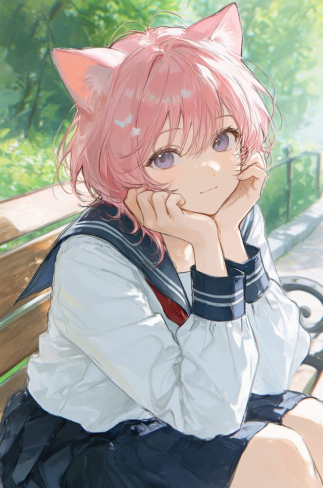

- **種類**：画風プリセット（Tsubaki.2・Tsubaki.3 系だけで有効）
- **見本のモデル**：Tsubaki.2
- **mode**：standard
- **指定**：`--style-preset colored-pencil-grain`（`--model tsubaki2`・`tsubaki3` 等と組み合わせる）

<details>
<summary>指定プロンプト</summary>

```text
1girl, solo, cat ears, serafuku, park, masterpiece, best quality
除外: text, speech bubble, panel border, watermark
seed: 20261025
mode: standard
```

</details>

---

## Seasonal Glow（cool-warm-oil-contrast）

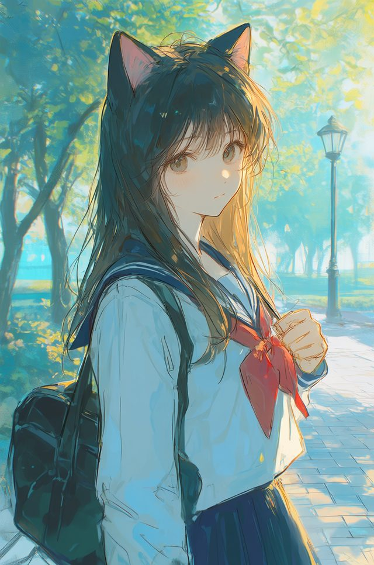

- **種類**：画風プリセット（Tsubaki.2・Tsubaki.3 系だけで有効）
- **見本のモデル**：Tsubaki.2
- **mode**：standard
- **指定**：`--style-preset cool-warm-oil-contrast`（`--model tsubaki2`・`tsubaki3` 等と組み合わせる）

<details>
<summary>指定プロンプト</summary>

```text
1girl, solo, cat ears, serafuku, park, masterpiece, best quality
除外: text, speech bubble, panel border, watermark
seed: 20261025
mode: standard
```

</details>

---

## Cool Softlight（desaturated-cool）


- **種類**：画風プリセット（Tsubaki.2・Tsubaki.3 系だけで有効）
- **見本のモデル**：Tsubaki.2
- **mode**：standard
- **指定**：`--style-preset desaturated-cool`（`--model tsubaki2`・`tsubaki3` 等と組み合わせる）

<details>
<summary>指定プロンプト</summary>

```text
1girl, solo, cat ears, serafuku, park, masterpiece, best quality
除外: text, speech bubble, panel border, watermark
seed: 20261025
mode: standard
```

</details>

---

## Pastel Flat（flat-anime-pastel）


- **種類**：画風プリセット（Tsubaki.2・Tsubaki.3 系だけで有効）
- **見本のモデル**：Tsubaki.2
- **mode**：standard
- **指定**：`--style-preset flat-anime-pastel`（`--model tsubaki2`・`tsubaki3` 等と組み合わせる）
- **注意**：このプリセットは、プロンプトにない頭の上の輪を描きやすい（除外に halo を入れても出た）。見本は、出た輪をインペイントで消したもの。

<details>
<summary>指定プロンプト</summary>

```text
1girl, solo, cat ears, serafuku, park, masterpiece, best quality
除外: text, speech bubble, panel border, watermark, halo
seed: 657280891
mode: standard
```

</details>

---

## Glassy Anime（glossy-glass-anime）

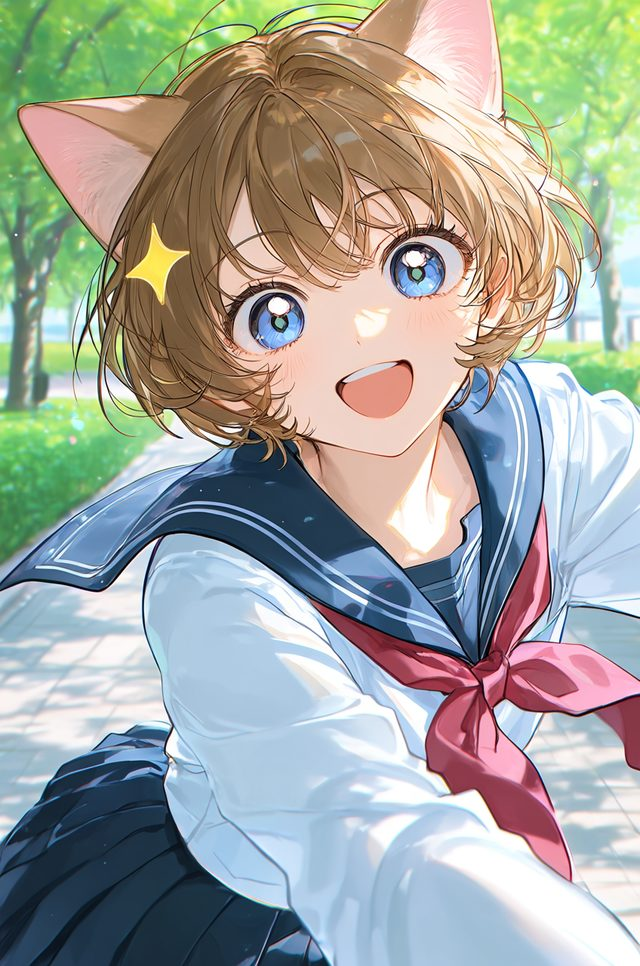

- **種類**：画風プリセット（Tsubaki.2・Tsubaki.3 系だけで有効）
- **見本のモデル**：Tsubaki.2
- **mode**：standard
- **指定**：`--style-preset glossy-glass-anime`（`--model tsubaki2`・`tsubaki3` 等と組み合わせる）

<details>
<summary>指定プロンプト</summary>

```text
1girl, solo, cat ears, serafuku, park, masterpiece, best quality
除外: text, speech bubble, panel border, watermark
seed: 20261025
mode: standard
```

</details>

---

## Grey Wash（grey-blocks-lineless）

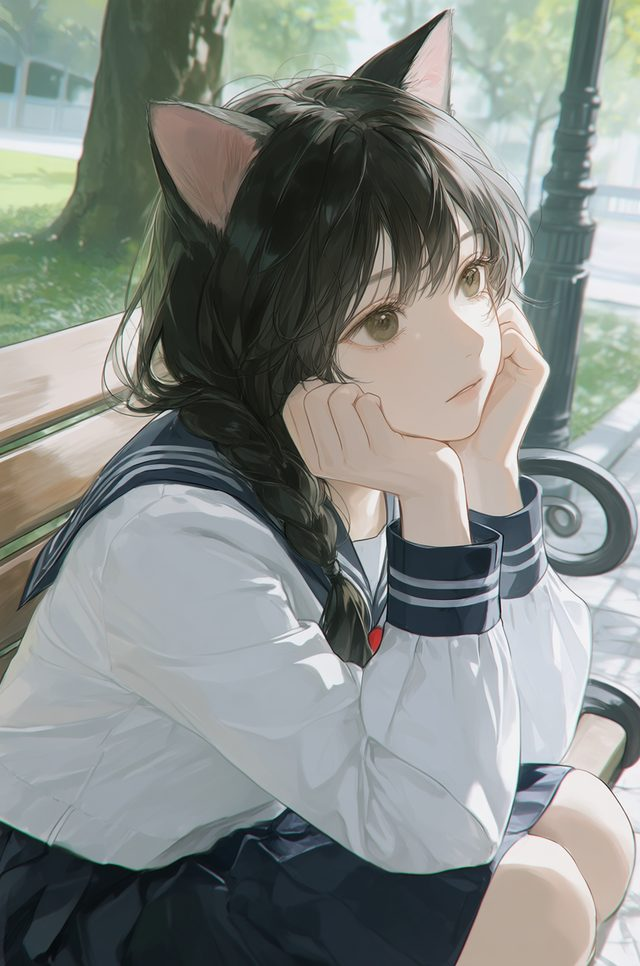

- **種類**：画風プリセット（Tsubaki.2・Tsubaki.3 系だけで有効）
- **見本のモデル**：Tsubaki.2
- **mode**：standard
- **指定**：`--style-preset grey-blocks-lineless`（`--model tsubaki2`・`tsubaki3` 等と組み合わせる）

<details>
<summary>指定プロンプト</summary>

```text
1girl, solo, cat ears, serafuku, park, masterpiece, best quality
除外: text, speech bubble, panel border, watermark
seed: 20261025
mode: standard
```

</details>

---

## Sharp Ink（hard-line-monochrome-accent）


- **種類**：画風プリセット（Tsubaki.2・Tsubaki.3 系だけで有効）
- **見本のモデル**：Tsubaki.2
- **mode**：standard
- **指定**：`--style-preset hard-line-monochrome-accent`（`--model tsubaki2`・`tsubaki3` 等と組み合わせる）

<details>
<summary>指定プロンプト</summary>

```text
1girl, solo, cat ears, serafuku, park, masterpiece, best quality
除外: text, speech bubble, panel border, watermark
seed: 20261025
mode: standard
```

</details>

---

## Neon Vivid（high-contrast-retro-vivid）


- **種類**：画風プリセット（Tsubaki.2・Tsubaki.3 系だけで有効）
- **見本のモデル**：Tsubaki.2
- **mode**：standard
- **指定**：`--style-preset high-contrast-retro-vivid`（`--model tsubaki2`・`tsubaki3` 等と組み合わせる）

<details>
<summary>指定プロンプト</summary>

```text
1girl, solo, cat ears, serafuku, park, masterpiece, best quality
除外: text, speech bubble, panel border, watermark
seed: 20261025
mode: standard
```

</details>

---

## Hyper Pop（holographic）


- **種類**：画風プリセット（Tsubaki.2・Tsubaki.3 系だけで有効）
- **見本のモデル**：Tsubaki.2
- **mode**：standard
- **指定**：`--style-preset holographic`（`--model tsubaki2`・`tsubaki3` 等と組み合わせる）

<details>
<summary>指定プロンプト</summary>

```text
1girl, solo, cat ears, serafuku, park, masterpiece, best quality
除外: text, speech bubble, panel border, watermark
seed: 20261025
mode: standard
```

</details>

---

## Polished Manhwa（korean-style）


- **種類**：画風プリセット（Tsubaki.2・Tsubaki.3 系だけで有効）
- **見本のモデル**：Tsubaki.2
- **mode**：standard
- **指定**：`--style-preset korean-style`（`--model tsubaki2`・`tsubaki3` 等と組み合わせる）

<details>
<summary>指定プロンプト</summary>

```text
1girl, solo, cat ears, serafuku, park, masterpiece, best quality
除外: text, speech bubble, panel border, watermark
seed: 20261025
mode: standard
```

</details>

---

## Luminous Wash（lineart-watercolor-airy）


- **種類**：画風プリセット（Tsubaki.2・Tsubaki.3 系だけで有効）
- **見本のモデル**：Tsubaki.2
- **mode**：standard
- **指定**：`--style-preset lineart-watercolor-airy`（`--model tsubaki2`・`tsubaki3` 等と組み合わせる）

<details>
<summary>指定プロンプト</summary>

```text
1girl, solo, cat ears, serafuku, park, masterpiece, best quality
除外: text, speech bubble, panel border, watermark
seed: 20261025
mode: standard
```

</details>

---

## Muted & Transparent（low-saturation-expressive-eyes）


- **種類**：画風プリセット（Tsubaki.2・Tsubaki.3 系だけで有効）
- **見本のモデル**：Tsubaki.2
- **mode**：standard
- **指定**：`--style-preset low-saturation-expressive-eyes`（`--model tsubaki2`・`tsubaki3` 等と組み合わせる）

<details>
<summary>指定プロンプト</summary>

```text
1girl, solo, cat ears, serafuku, park, masterpiece, best quality
除外: text, speech bubble, panel border, watermark
seed: 20261025
mode: standard
```

</details>

---

## Lucid Dreamy（lucid-dreamy）

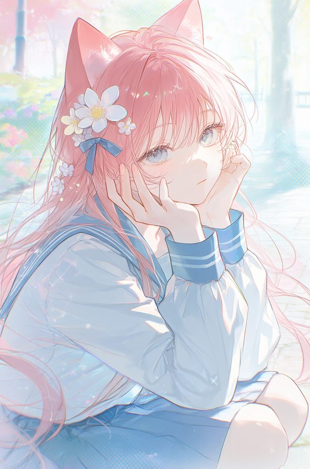

- **種類**：画風プリセット（Tsubaki.2・Tsubaki.3 系だけで有効）
- **見本のモデル**：Tsubaki.2
- **mode**：standard
- **指定**：`--style-preset lucid-dreamy`（`--model tsubaki2`・`tsubaki3` 等と組み合わせる）

<details>
<summary>指定プロンプト</summary>

```text
1girl, solo, cat ears, serafuku, park, masterpiece, best quality
除外: text, speech bubble, panel border, watermark
seed: 20261025
mode: standard
```

</details>

---

## Luminous Impasto（luminous-retro-impasto）


- **種類**：画風プリセット（Tsubaki.2・Tsubaki.3 系だけで有効）
- **見本のモデル**：Tsubaki.2
- **mode**：standard
- **指定**：`--style-preset luminous-retro-impasto`（`--model tsubaki2`・`tsubaki3` 等と組み合わせる）

<details>
<summary>指定プロンプト</summary>

```text
1girl, solo, cat ears, serafuku, park, masterpiece, best quality
除外: text, speech bubble, panel border, watermark
seed: 20261025
mode: standard
```

</details>

---

## Minimal Flat（minimal-flat-color）


- **種類**：画風プリセット（Tsubaki.2・Tsubaki.3 系だけで有効）
- **見本のモデル**：Tsubaki.2
- **mode**：standard
- **指定**：`--style-preset minimal-flat-color`（`--model tsubaki2`・`tsubaki3` 等と組み合わせる）

<details>
<summary>指定プロンプト</summary>

```text
1girl, solo, cat ears, serafuku, park, masterpiece, best quality
除外: text, speech bubble, panel border, watermark
seed: 20261025
mode: standard
```

</details>

---

## Modern Glam Anime（modern-oil-glamour）


- **種類**：画風プリセット（Tsubaki.2・Tsubaki.3 系だけで有効）
- **見本のモデル**：Tsubaki.2
- **mode**：standard
- **指定**：`--style-preset modern-oil-glamour`（`--model tsubaki2`・`tsubaki3` 等と組み合わせる）

<details>
<summary>指定プロンプト</summary>

```text
1girl, solo, cat ears, serafuku, park, masterpiece, best quality
除外: text, speech bubble, panel border, watermark
seed: 20261025
mode: standard
```

</details>

---

## Moe Pastel（moe-pastel）

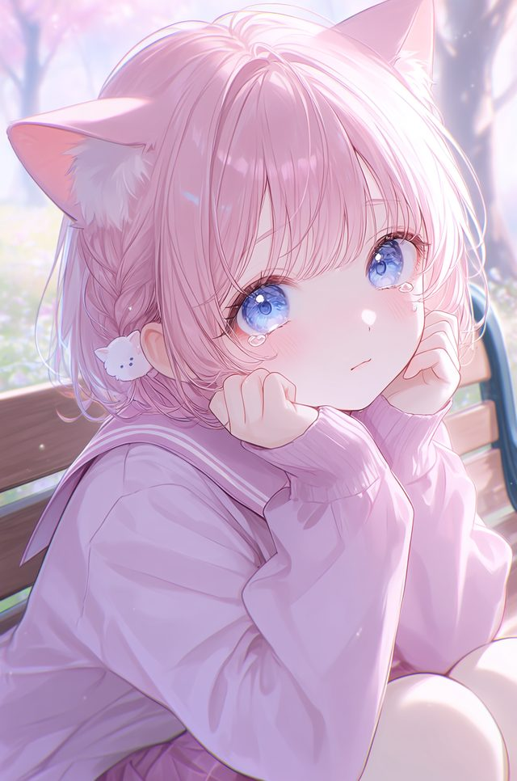

- **種類**：画風プリセット（Tsubaki.2・Tsubaki.3 系だけで有効）
- **見本のモデル**：Tsubaki.2
- **mode**：standard
- **指定**：`--style-preset moe-pastel`（`--model tsubaki2`・`tsubaki3` 等と組み合わせる）

<details>
<summary>指定プロンプト</summary>

```text
1girl, solo, cat ears, serafuku, park, masterpiece, best quality
除外: text, speech bubble, panel border, watermark
seed: 20261025
mode: standard
```

</details>

---

## Water-Infused Oil（oil-watercolor-blend）

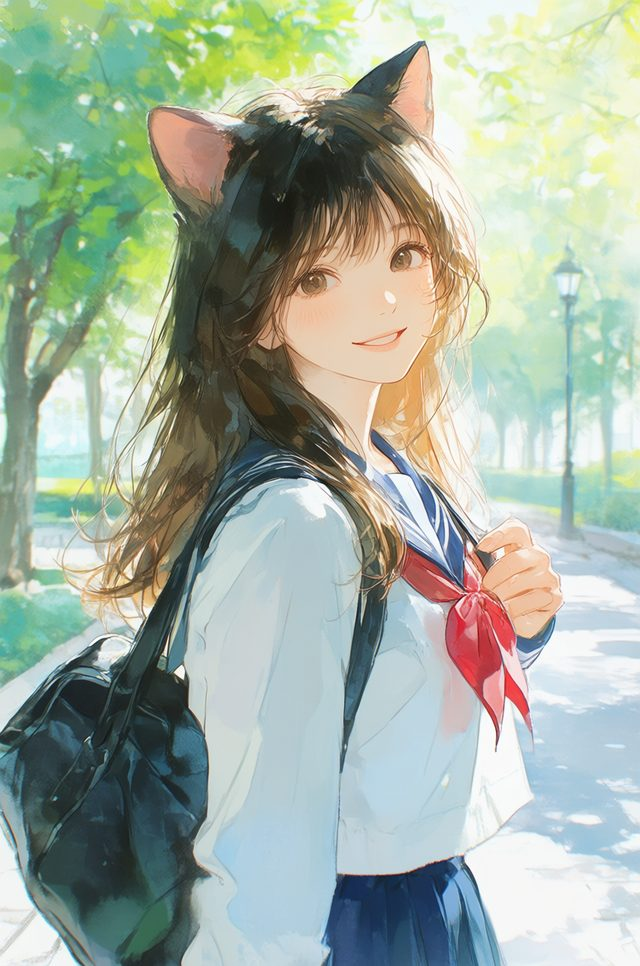

- **種類**：画風プリセット（Tsubaki.2・Tsubaki.3 系だけで有効）
- **見本のモデル**：Tsubaki.2
- **mode**：standard
- **指定**：`--style-preset oil-watercolor-blend`（`--model tsubaki2`・`tsubaki3` 等と組み合わせる）

<details>
<summary>指定プロンプト</summary>

```text
1girl, solo, cat ears, serafuku, park, masterpiece, best quality
除外: text, speech bubble, panel border, watermark
seed: 20261025
mode: standard
```

</details>

---

## Tender Brushstroke（painterly-doodle）


- **種類**：画風プリセット（Tsubaki.2・Tsubaki.3 系だけで有効）
- **見本のモデル**：Tsubaki.2
- **mode**：standard
- **指定**：`--style-preset painterly-doodle`（`--model tsubaki2`・`tsubaki3` 等と組み合わせる）

<details>
<summary>指定プロンプト</summary>

```text
1girl, solo, cat ears, serafuku, park, masterpiece, best quality
除外: text, speech bubble, panel border, watermark
seed: 20261025
mode: standard
```

</details>

---

## Soft Aqueous（paper-watercolor）

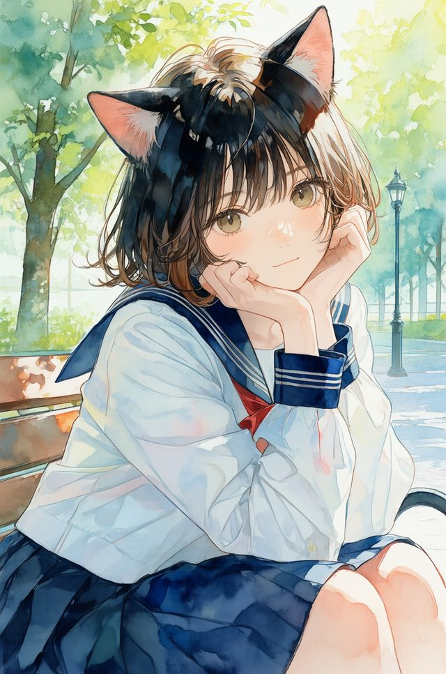

- **種類**：画風プリセット（Tsubaki.2・Tsubaki.3 系だけで有効）
- **見本のモデル**：Tsubaki.2
- **mode**：standard
- **指定**：`--style-preset paper-watercolor`（`--model tsubaki2`・`tsubaki3` 等と組み合わせる）

<details>
<summary>指定プロンプト</summary>

```text
1girl, solo, cat ears, serafuku, park, masterpiece, best quality
除外: text, speech bubble, panel border, watermark
seed: 20261025
mode: standard
```

</details>

---

## Pencil Sketch（pencil-sketch）


- **種類**：画風プリセット（Tsubaki.2・Tsubaki.3 系だけで有効）
- **見本のモデル**：Tsubaki.2
- **mode**：standard
- **指定**：`--style-preset pencil-sketch`（`--model tsubaki2`・`tsubaki3` 等と組み合わせる）

<details>
<summary>指定プロンプト</summary>

```text
1girl, solo, cat ears, serafuku, park, masterpiece, best quality
除外: text, speech bubble, panel border, watermark
seed: 20261025
mode: standard
```

</details>

---

## Neon Poster（poster-graffiti）

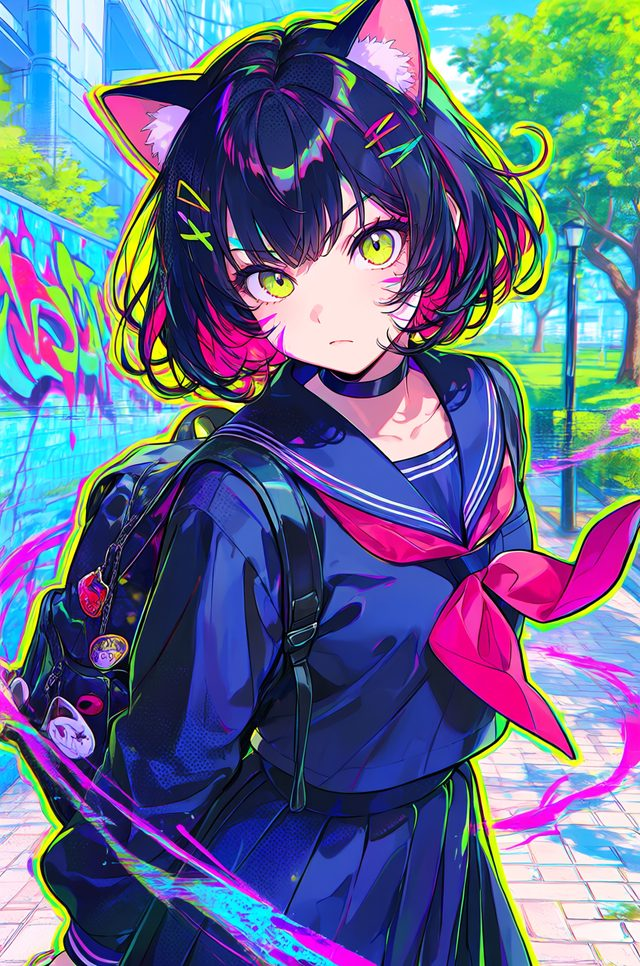

- **種類**：画風プリセット（Tsubaki.2・Tsubaki.3 系だけで有効）
- **見本のモデル**：Tsubaki.2
- **mode**：standard
- **指定**：`--style-preset poster-graffiti`（`--model tsubaki2`・`tsubaki3` 等と組み合わせる）

<details>
<summary>指定プロンプト</summary>

```text
1girl, solo, cat ears, serafuku, park, masterpiece, best quality
除外: text, speech bubble, panel border, watermark
seed: 20261025
mode: standard
```

</details>

---

## Retro Fusion（retro-comic-fusion）

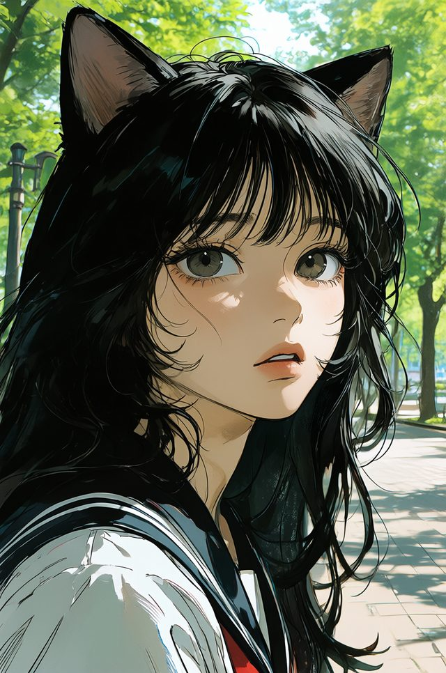

- **種類**：画風プリセット（Tsubaki.2・Tsubaki.3 系だけで有効）
- **見本のモデル**：Tsubaki.2
- **mode**：standard
- **指定**：`--style-preset retro-comic-fusion`（`--model tsubaki2`・`tsubaki3` 等と組み合わせる）

<details>
<summary>指定プロンプト</summary>

```text
1girl, solo, cat ears, serafuku, park, masterpiece, best quality
除外: text, speech bubble, panel border, watermark
seed: 20261025
mode: standard
```

</details>

---

## Retro Glam Anime（retro-oil-glamour）


- **種類**：画風プリセット（Tsubaki.2・Tsubaki.3 系だけで有効）
- **見本のモデル**：Tsubaki.2
- **mode**：standard
- **指定**：`--style-preset retro-oil-glamour`（`--model tsubaki2`・`tsubaki3` 等と組み合わせる）

<details>
<summary>指定プロンプト</summary>

```text
1girl, solo, cat ears, serafuku, park, masterpiece, best quality
除外: text, speech bubble, panel border, watermark
seed: 20261025
mode: standard
```

</details>

---

## 90s Retro-Cell（retro-tv-anime）

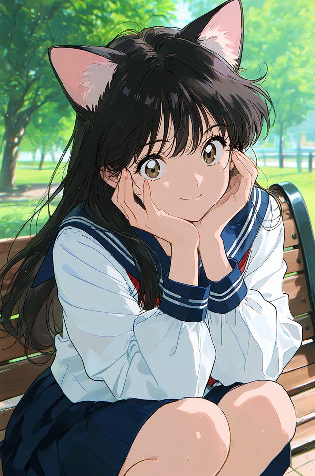

- **種類**：画風プリセット（Tsubaki.2・Tsubaki.3 系だけで有効）
- **見本のモデル**：Tsubaki.2
- **mode**：standard
- **指定**：`--style-preset retro-tv-anime`（`--model tsubaki2`・`tsubaki3` 等と組み合わせる）

<details>
<summary>指定プロンプト</summary>

```text
1girl, solo, cat ears, serafuku, park, masterpiece, best quality
除外: text, speech bubble, panel border, watermark
seed: 20261025
mode: standard
```

</details>

---

## Semi-Real（semi-realistic）


- **種類**：画風プリセット（Tsubaki.2・Tsubaki.3 系だけで有効）
- **見本のモデル**：Tsubaki.2
- **mode**：standard
- **指定**：`--style-preset semi-realistic`（`--model tsubaki2`・`tsubaki3` 等と組み合わせる）

<details>
<summary>指定プロンプト</summary>

```text
1girl, solo, cat ears, serafuku, park, masterpiece, best quality
除外: text, speech bubble, panel border, watermark
seed: 20261025
mode: standard
```

</details>

---

## Neon Vaporwave（stable-vaporwave）

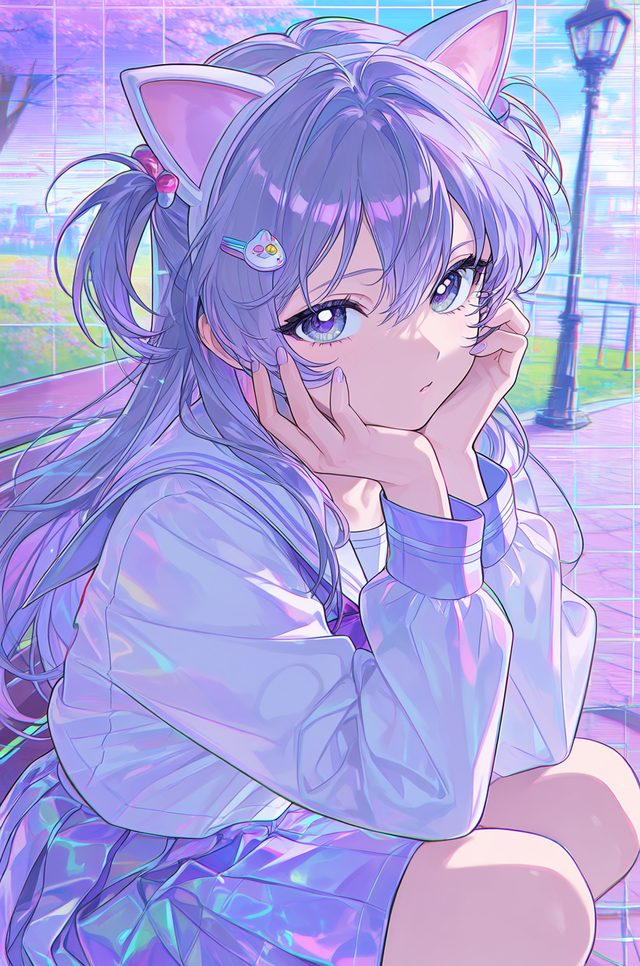

- **種類**：画風プリセット（Tsubaki.2・Tsubaki.3 系だけで有効）
- **見本のモデル**：Tsubaki.2
- **mode**：standard
- **指定**：`--style-preset stable-vaporwave`（`--model tsubaki2`・`tsubaki3` 等と組み合わせる）

<details>
<summary>指定プロンプト</summary>

```text
1girl, solo, cat ears, serafuku, park, masterpiece, best quality
除外: text, speech bubble, panel border, watermark
seed: 20261025
mode: standard
```

</details>

---

## Tinted Sketch（tinted-sketch）

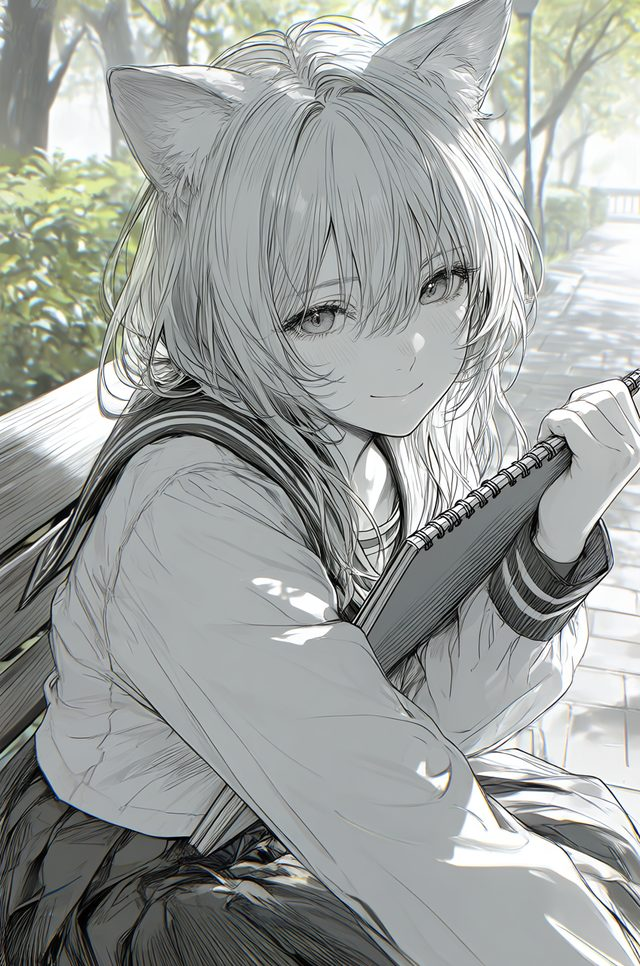

- **種類**：画風プリセット（Tsubaki.2・Tsubaki.3 系だけで有効）
- **見本のモデル**：Tsubaki.2
- **mode**：standard
- **指定**：`--style-preset tinted-sketch`（`--model tsubaki2`・`tsubaki3` 等と組み合わせる）

<details>
<summary>指定プロンプト</summary>

```text
1girl, solo, cat ears, serafuku, park, masterpiece, best quality
除外: text, speech bubble, panel border, watermark
seed: 20261025
mode: standard
```

</details>

---

## Vintage Collage（vintage-collage）


- **種類**：画風プリセット（Tsubaki.2・Tsubaki.3 系だけで有効）
- **見本のモデル**：Tsubaki.2
- **mode**：standard
- **指定**：`--style-preset vintage-collage`（`--model tsubaki2`・`tsubaki3` 等と組み合わせる）

<details>
<summary>指定プロンプト</summary>

```text
1girl, solo, cat ears, serafuku, park, masterpiece, best quality
除外: text, speech bubble, panel border, watermark
seed: 20261025
mode: standard
```

</details>
